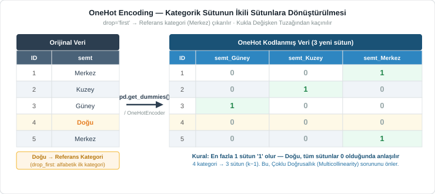
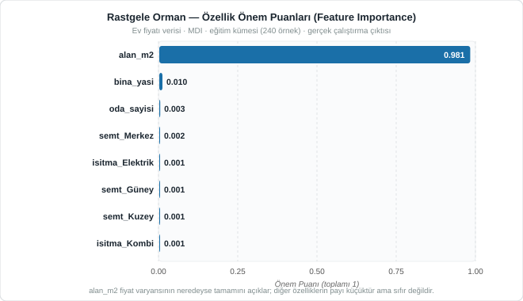
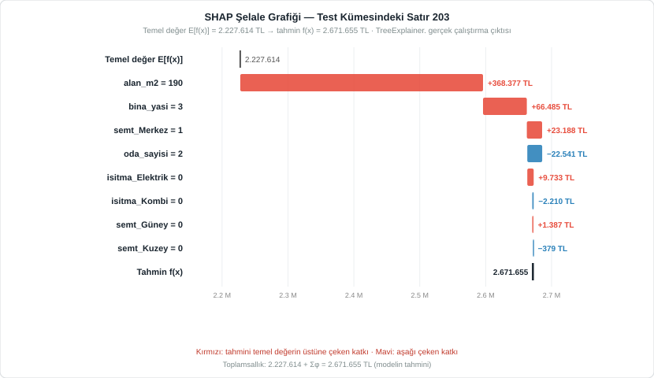
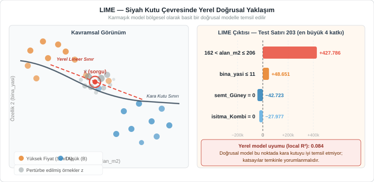
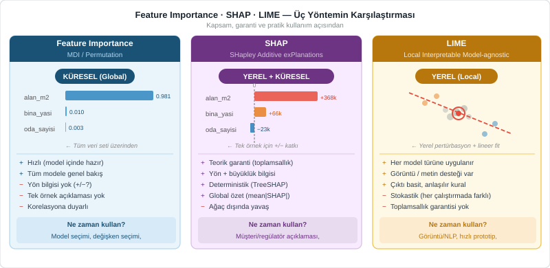
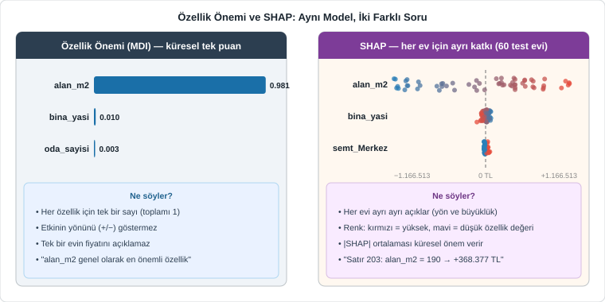

# Makine Öğrenmesinde Yorumlanabilirlik: Özellik Önemi, SHAP, LIME ve Kategorik Kodlama

Bir model kurmak bir iştir, o modeli anlamak başka bir iştir. Modelin kararından etkilenen kişi (bir müşteri, bir hekim ya da bir yönetici) çoğu zaman modelin koduyla ya da matematiğiyle ilgilenmez; ona "algoritma bu sonucu verdi" demek yeterli değildir. Bu ders notunda dört araç ele alınmaktadır: kategorik değişkenleri modele hazırlayan **OneHot Encoding** ile modeli açıklayan **Özellik Önemi** (Feature Importance), **SHAP** ve **LIME**. Bu araçlar yorumlanabilir makine öğrenmesinin (Interpretable Machine Learning, IML) temel taşlarıdır.

Dört kavram ortak bir örnek üzerinde işlenecektir: **ev fiyatı tahmini**. Veri kümesinde hem sayısal hem kategorik değişkenler bulunduğundan OneHot Encoding'in neden gerektiği ve açıklama yöntemlerinin birbirinden nasıl ayrıştığı aynı veri üzerinde görülebilir.

> **Çalıştırma ortamı.** Bu nottaki tüm çıktılar, kod blokları sırayla çalıştırılarak Python 3.12, NumPy 2.5, pandas 3.1, scikit-learn 1.9, shap 0.54 ve lime 0.2 ile elde edilmiştir. Gerekli paketler: `pip install pandas scikit-learn matplotlib shap lime` (bkz. depodaki `requirements.txt`). Farklı sürümlerde son basamaklar değişebilir.

---

## Ortak Veri Seti: Ev Fiyatı Tahmini

Veri kümesi 300 satırdan oluşan yapay (sentetik) bir veridir ve şu değişkenleri içerir:

| Değişken | Tür | Açıklama |
| --- | --- | --- |
| `alan_m2` | Sayısal | Evin net alanı (m²) |
| `bina_yasi` | Sayısal | Binanın yaşı (yıl) |
| `oda_sayisi` | Sayısal (1–5) | Oda sayısı |
| `semt` | Kategorik | Merkez / Kuzey / Güney / Doğu |
| `isitma` | Kategorik | Doğalgaz / Elektrik / Kombi |
| `fiyat_tl` | Hedef | Satış fiyatı (TL) |

Verinin nasıl üretildiğini bilmek, açıklama yöntemlerinin çıktılarını "doğru cevapla" karşılaştırmamızı sağlar. Fiyat; metrekare başına 12.000 TL, binanın yeniliğine göre yıl başına 5.000 TL, oda başına 25.000 TL, semt ve ısıtma primleri ile ortalaması 0, standart sapması 60.000 TL olan rastgele bir gürültüden oluşur.

```python
import pandas as pd
import numpy as np

np.random.seed(42)
n = 300

df = pd.DataFrame({
    'alan_m2':    np.random.randint(60, 250, n),
    'bina_yasi':  np.random.randint(0, 40, n),
    'oda_sayisi': np.random.choice([1, 2, 3, 4, 5], n,
                                   p=[0.05, 0.20, 0.40, 0.25, 0.10]),
    'semt':       np.random.choice(['Merkez','Kuzey','Güney','Doğu'], n,
                                   p=[0.30, 0.25, 0.25, 0.20]),
    'isitma':     np.random.choice(['Doğalgaz','Elektrik','Kombi'], n,
                                   p=[0.50, 0.30, 0.20])
})

semt_prim    = {'Merkez': 200_000, 'Kuzey': 120_000,
                'Güney':   80_000, 'Doğu':   50_000}
isitma_prim  = {'Doğalgaz': 30_000, 'Elektrik': -10_000, 'Kombi': 15_000}

df['fiyat_tl'] = (
    df['alan_m2']   * 12_000
    + (40 - df['bina_yasi']) * 5_000
    + df['oda_sayisi']       * 25_000
    + df['semt'].map(semt_prim)
    + df['isitma'].map(isitma_prim)
    + np.random.normal(0, 60_000, n)
).clip(lower=0).astype(int)

print(df.head())
```

Çıktı:

```text
   alan_m2  bina_yasi  oda_sayisi   semt    isitma  fiyat_tl
0      162         17           3  Kuzey  Doğalgaz   2319987
1      239          1           3  Güney  Doğalgaz   3316012
2      152         34           4  Güney  Doğalgaz   1987366
3       74         15           4   Doğu  Elektrik   1060073
4      166         35           4  Güney  Doğalgaz   2301779
```

---

## 1. OneHot Encoding (Tek-Etkin Kodlama)

Regresyon ve karar ağacı modellerinin scikit-learn uygulamaları yalnızca sayısal girdi kabul eder; `"Merkez"` gibi bir metin değeri içeren veri modele verilirse eğitim hata vererek durur. Bu nedenle kategorik değişkenler önce sayılara çevrilmelidir.

### 1.1 İlk Akla Gelen Yöntem ve Neden Yanlış Olduğu

Bir öğrenci şunu önerebilir: "Semtlere sıra numarası vereyim: Merkez = 0, Kuzey = 1, Güney = 2, Doğu = 3." Bu yaklaşıma **etiket kodlama** (label encoding) denir. Hızlıdır ve tek sütuna sığar; ancak önemli bir sorun taşır.

Sıra numarası veren bu kodlama modele şunu söyler: "Doğu (3), Kuzey'in (1) üç katıdır; Merkez (0) ile Doğu (3) arasındaki fark, Merkez ile Kuzey (1) arasındaki farkın üç katıdır." Bu ilişkilerin hiçbiri gerçek değildir. Semt adları arasında sıra ya da büyüklük ilişkisi yoktur; birbirinden bağımsız, eşit düzeyde kategorilerdir.

Çantadaki kalemlerin renklerini "kırmızı = 1, mavi = 2, yeşil = 3" diye kodlamak, modele "kırmızı ile mavinin toplamı yeşildir" demek gibidir.

### 1.2 Doğru Yaklaşım: Bir Sütunu Birden Fazla Sütuna Yaymak

**OneHot Encoding** her kategori için ayrı bir ikili (binary) sütun açar. Bir satırda hangi kategori geçerliyse o sütunun değeri `1`, diğerleri `0` olur. Terim sayısal elektronikten gelir: "one-hot" kodlamada bir bit dizisindeki bitlerden yalnızca biri "sıcak", yani etkin (1) durumdadır.



### 1.3 Kukla Değişken Tuzağı (Dummy Variable Trap)

Dört semt için dört sütun mu açılmalıdır? Doğrusal regresyonda bu bir sorun yaratır. Dört kategori için dört sütun açıldığında sütunlardan biri her zaman diğer üçünün bir fonksiyonudur:

```text
semt_Doğu = 1 − semt_Güney − semt_Kuzey − semt_Merkez
```

Sabit terimli (intercept) doğrusal regresyon gibi en küçük kareler (ordinary least squares, OLS) yöntemlerinde bu tam doğrusal bağımlılık, $X^{T}X$ matrisini tekil (singular) yapar: Matrisin tersi yoktur ve katsayılar tek biçimde belirlenemez. Bu duruma **tam çoklu doğrusallık** (perfect multicollinearity) denir. Düzenlileştirme (regularization) kullanan modeller, ağaç tabanlı modeller ve yapay sinir ağları matris tersi almadığı için bu tuzağa düşmez; ancak gereksiz bir sütunun atılması onlar için de zararsızdır.

Çözüm basittir: $k$ kategori için $k-1$ sütun açılır. Dışarıda bırakılan kategori **referans kategori** olur ve diğer sütunların katsayıları bu referansa göre yorumlanır. `pandas`'ta `drop_first=True`, scikit-learn'de `drop='first'` bunu yapar. Her ikisi de kategorileri **alfabetik** sıralayıp ilkini atar; bu veride referans kategoriler `Doğu` ve `Doğalgaz` olur.

```python
# Yöntem 1: pandas ile
X_encoded = pd.get_dummies(
    df.drop('fiyat_tl', axis=1),
    columns=['semt', 'isitma'],
    drop_first=True,   # kukla değişken tuzağından kaçınmak için
    dtype=int          # True/False yerine 1/0
)
print(X_encoded.columns.tolist())
```

Çıktı:

```text
['alan_m2', 'bina_yasi', 'oda_sayisi', 'semt_Güney', 'semt_Kuzey', 'semt_Merkez', 'isitma_Elektrik', 'isitma_Kombi']
```

```python
# Yöntem 2: scikit-learn ColumnTransformer ile (iş hattı / pipeline için önerilir)
from sklearn.preprocessing import OneHotEncoder
from sklearn.compose import ColumnTransformer

kategorik_sutunlar = ['semt', 'isitma']
sayisal_sutunlar   = ['alan_m2', 'bina_yasi', 'oda_sayisi']

preprocessor = ColumnTransformer(transformers=[
    ('cat', OneHotEncoder(drop='first', sparse_output=False), kategorik_sutunlar),
    ('num', 'passthrough', sayisal_sutunlar)
])

X_transformed = preprocessor.fit_transform(df.drop('fiyat_tl', axis=1))
print(X_transformed.shape)
print(preprocessor.get_feature_names_out().tolist())
```

Çıktı:

```text
(300, 8)
['cat__semt_Güney', 'cat__semt_Kuzey', 'cat__semt_Merkez', 'cat__isitma_Elektrik', 'cat__isitma_Kombi', 'num__alan_m2', 'num__bina_yasi', 'num__oda_sayisi']
```

### 1.4 Ne Zaman OneHot, Ne Zaman Başka Bir Yöntem?

Kategori sayısı azsa (yaklaşık 2–15) ve kategoriler arasında sıra yoksa OneHot Encoding doğru tercihtir. Bazı durumlar farklı yaklaşımlar gerektirir:

| Durum | Öneri |
| --- | --- |
| Sıralı anlam var (örneğin `Düşük < Orta < Yüksek`) | Sıralı kodlama (Ordinal Encoding) |
| Çok sayıda kategori (örneğin ilçe adları, yaklaşık 250 ülke kodu) | Hedef kodlama (Target Encoding) ya da gömme (embedding) |
| Yalnızca ağaç tabanlı model kullanılıyor | Etiket kodlama da kabul edilebilir |
| Yüksek kardinalitenin belleği zorladığı durumlar | Özetleme kodlaması (Hashing Encoding) |

Ağaç tabanlı modeller (karar ağacı, Rastgele Orman / Random Forest, XGBoost) etiket kodlamayla da çalışabilir; çünkü sayıların büyüklüğünü değil yalnızca eşik karşılaştırmalarını kullanırlar. Yine de etiket kodlamanın yarattığı yapay sıra, ağacın kategorileri gruplamak için daha fazla bölünme yapmasına yol açabilir. Doğrusal modellerde ve sinir ağlarında OneHot Encoding tercih edilmelidir.

---

## 2. Özellik Önemi (Feature Importance)

Model eğitildi ve doğruluk ölçütleri tatmin edici olsun. Sıradaki doğal soru şudur: "Bu model hangi değişkenlere bakarak karar veriyor?" Özellik önemi bu soruya sayısal bir yanıt verir.

### 2.1 Karar Ağacında Safsızlığın Azalması

Bir karar ağacı (decision tree) veriyi adım adım böler. Her düğümde bir kural sorar: "`alan_m2` > 150 mi?" Bölünmeden sonra oluşan iki grup kendi içinde daha türdeşse (homojen) bu özellik iyi bir ayırıcıdır. Türdeşlik bir **safsızlık** (impurity) ölçütüyle ölçülür ve ölçüt problemin türüne göre değişir.

**Sınıflandırmada** en yaygın ölçüt Gini safsızlığıdır (Gini impurity; İtalyan istatistikçi Corrado Gini'den):

$$G(D) = 1 - \sum_{k=1}^{K} p_k^2$$

Burada $p_k$, $D$ düğümündeki $k$ sınıfının oranıdır. Düğümdeki tüm örnekler aynı sınıftaysa $G = 0$ olur. En büyük değer, sınıfların eşit dağıldığı durumda $1 - 1/K$'dir; iki sınıfta $0.5$, dört sınıfta $0.75$. Entropi tabanlı ölçüt kullanıldığında safsızlıktaki azalmaya **bilgi kazancı** (information gain) denir.

```math
\underbrace{G(D)}_{\substack{D \text{ düğümünün}\\\text{Gini safsızlığı}}} = 1 - \overbrace{\sum_{k=1}^{K}}^{\substack{\text{tüm}\\\text{sınıflar}}} \underbrace{p_k^2}_{\substack{k \text{ sınıfının}\\\text{oranının karesi}}}
```

**Ne anlatıyor?** Düğümden yerine koyarak rastgele iki örnek seçildiğinde ikisinin aynı sınıftan olma olasılığı, sınıf oranlarının karelerinin toplamıdır; Gini safsızlığı bunun tümleyeni, yani iki örneğin farklı sınıflardan çıkma olasılığıdır. Düğüm ne kadar karışıksa bu olasılık o kadar büyür.

**Regresyonda** (bu nottaki ev fiyatı problemi) safsızlık, düğümdeki hedef değerlerin varyansı, yani ortalama kare hatadır (mean squared error, MSE):

$$\text{MSE}(D) = \frac{1}{|D|} \sum_{i \in D} \left(y_i - \bar{y}_D\right)^2$$

```math
\underbrace{\text{MSE}(D)}_{\substack{D \text{ düğümünün}\\\text{safsızlığı}}} = \overbrace{\frac{1}{|D|} \sum_{i \in D}}^{\substack{\text{düğümdeki örnekler}\\\text{üzerinden ortalama}}} \big(\underbrace{y_i - \bar{y}_D}_{\substack{\text{hedef değerin düğüm}\\\text{ortalamasından sapması}}}\big)^2
```

**Ne anlatıyor?** Düğüm, hedef değerlerin ortalamasını tahmin olarak verir; MSE bu tahminin her örnekteki hatasının karesinin ortalamasıdır. Düğümdeki değerler birbirine ne kadar yakınsa safsızlık o kadar küçüktür.

Hangi ölçüt kullanılırsa kullanılsın, $j$ özelliğiyle yapılan bir bölünmenin sağladığı safsızlık azalması şöyledir:

$$\Delta I(D, j) = I(D) - \frac{|D_L|}{|D|} \cdot I(D_L) - \frac{|D_R|}{|D|} \cdot I(D_R)$$

Burada $I$ safsızlık ölçütü (Gini ya da MSE), $D_L$ ve $D_R$ bölünme sonucunda oluşan sol ve sağ alt kümelerdir.

```math
\underbrace{\Delta I(D, j)}_{\substack{j \text{ ile bölünmenin}\\\text{safsızlık azalması}}} = \overbrace{I(D)}^{\substack{\text{bölünme öncesi}\\\text{safsızlık}}} - \underbrace{\frac{|D_L|}{|D|} \cdot I(D_L)}_{\substack{\text{sol dalın ağırlıklı}\\\text{safsızlığı}}} - \overbrace{\frac{|D_R|}{|D|} \cdot I(D_R)}^{\substack{\text{sağ dalın ağırlıklı}\\\text{safsızlığı}}}
```

**Ne anlatıyor?** Bölünmeden önceki safsızlıktan, iki alt kümenin örnek sayılarıyla orantılı olarak ağırlıklandırılmış safsızlıkları çıkarılır. Fark ne kadar büyükse $j$ özelliğiyle yapılan bölünme grupları o kadar türdeş hâle getirmiştir.

### 2.2 Rastgele Ormanda Özellik Önemi

Rastgele Orman (Random Forest) çok sayıda karar ağacından oluşur. Her ağaç verinin yerine koymalı bir örneklemi (bootstrap) üzerinde eğitilir ve **her bölünmede** aday özellikler rastgele bir alt kümeden seçilir (Breiman, 2001). Bu alt kümenin büyüklüğünü `max_features` belirler; scikit-learn'de `RandomForestRegressor` için varsayılan değer `1.0`'dır, yani regresyonda varsayılan olarak her bölünmede tüm özellikler değerlendirilir ve rastgelelik yalnızca örneklemeden gelir.

Bir özelliğin ormandaki önem puanı, o özelliğin kullanıldığı tüm düğümlerdeki ağırlıklı safsızlık azalmalarının ağaçlar üzerinden ortalamasıdır:

$$\text{FI}(j) = \frac{1}{B} \sum_{b=1}^{B} \sum_{\substack{t \in T_b \\ \text{split}(t)=j}} \frac{n_t}{N} \cdot \Delta I_t$$

Burada $B$ ağaç sayısı, $T_b$ $b$'inci ağacın düğümleri, $n_t$ $t$ düğümüne düşen örnek sayısı ve $N$ toplam örnek sayısıdır. Bu yönteme **MDI** (Mean Decrease in Impurity, ortalama safsızlık azalması) denir. scikit-learn her ağacın puanlarını toplamı 1 olacak biçimde normalleştirir; bu nedenle puanlar 0 ile 1 arasındadır ve toplamları 1'dir.

```math
\underbrace{\text{FI}(j)}_{\substack{j \text{ özelliğinin}\\\text{önem puanı}}} = \overbrace{\frac{1}{B} \sum_{b=1}^{B}}^{\substack{\text{ağaçlar üzerinden}\\\text{ortalama}}} \underbrace{\sum_{\substack{t \in T_b \\ \text{split}(t)=j}}}_{\substack{j \text{ ile bölünen}\\\text{tüm düğümler}}} \overbrace{\frac{n_t}{N}}^{\substack{\text{düğüme düşen}\\\text{örnek oranı}}} \cdot \underbrace{\Delta I_t}_{\substack{\text{düğümdeki}\\\text{safsızlık azalması}}}
```

**Ne anlatıyor?** Bir özelliğin her ağaçta kullanıldığı düğümlerdeki safsızlık azalmaları, o düğümlere düşen örnek oranıyla ağırlıklandırılarak toplanır ve ağaçlar üzerinden ortalaması alınır. Çok sayıda örneği etkileyen ve safsızlığı belirgin biçimde azaltan bölünmelerde kullanılan özellik yüksek puan alır.

### 2.3 Kod Örneği: Özellik Önemi

Model eğitilmeden önce veri eğitim ve test kümelerine ayrılır; açıklama yöntemleri de daha sonra bu aynı model ve aynı test kümesi üzerinde çalıştırılacaktır.

```python
from sklearn.ensemble import RandomForestRegressor
from sklearn.model_selection import train_test_split
import matplotlib.pyplot as plt

X = X_encoded
y = df['fiyat_tl']
X_train, X_test, y_train, y_test = train_test_split(
    X, y, test_size=0.2, random_state=42
)

rf = RandomForestRegressor(n_estimators=200, max_depth=12,
                           random_state=42, n_jobs=-1)
rf.fit(X_train, y_train)
print(f"Test R²: {rf.score(X_test, y_test):.4f}")

# Önem puanlarını al ve sırala
fi_series = pd.Series(rf.feature_importances_, index=X.columns)
fi_series = fi_series.sort_values(ascending=False)
print(fi_series.round(3))

# Görselleştir
fi_series.sort_values().plot(kind='barh', figsize=(8, 5), color='steelblue')
plt.xlabel('Önem Puanı')
plt.title('Feature Importance — Rastgele Orman')
plt.tight_layout()
plt.savefig('feature_importance.png', dpi=150)
plt.show()
```

Çıktı:

```text
Test R²: 0.9867
alan_m2            0.981
bina_yasi          0.010
oda_sayisi         0.003
semt_Merkez        0.002
isitma_Elektrik    0.001
semt_Güney         0.001
semt_Kuzey         0.001
isitma_Kombi       0.001
dtype: float64
```



Sonuç ilk bakışta şaşırtıcı görünebilir: Semt primi 50.000 ile 200.000 TL arasında değiştiği hâlde `semt_Merkez`'in payı yalnızca 0.002'dir. Bunun nedeni verinin yapısıdır. `alan_m2` 60–249 m² arasında değiştiği için tek başına yaklaşık 2,3 milyon TL'lik bir fark yaratır; fiyat varyansının neredeyse tamamı alandan gelir. MDI, safsızlığı (burada varyansı) en çok azaltan özelliği ödüllendirir; bu nedenle diğer özelliklerin göreli payı çok küçük kalır. Bu durum, önem puanlarının "etkinin TL cinsinden büyüklüğünü" değil "varyans azaltmadaki payı" gösterdiğini hatırlatır.

### 2.4 Özellik Öneminin Sınırları

Bu yöntem kullanışlıdır, ancak sonuçlarına körü körüne güvenilmemelidir.

**Birinci sorun: Yön bilgisi yoktur.** Sonuç "`alan_m2` önemli" der; ancak "büyük alan fiyatı artırır mı, azaltır mı ve ne kadar?" sorusunu yanıtlamaz.

**İkinci sorun: Küreseldir (global).** Tek bir puan tüm veri kümesini temsil eder. Bir evin fiyatında hangi özelliğin ne kadar rol oynadığını, örneğin merkezdeki küçük ama pahalı bir dairede alanın belirleyici olup olmadığını göstermez.

**Üçüncü sorun: İlişkili özellikler.** İki özellik birbiriyle güçlü biçimde ilişkiliyse (örneğin gerçek bir veri kümesinde alan ile oda sayısı) ağaçlar bölünmelerde bazen birini, bazen diğerini kullanır ve önem puanı ikisi arasında paylaşılır. İkisi de olduğundan düşük görünebilir. Bu nottaki yapay veride alan ile oda sayısı birbirinden bağımsız üretilmiştir (korelasyon katsayısı −0.031); bu yüzden burada böyle bir paylaşım görülmez.

**Dördüncü sorun: Yanlılık.** MDI eğitim verisi üzerinden hesaplanır ve çok sayıda farklı değer alan sürekli özellikleri, az değerli (örneğin ikili) özelliklere göre kayırma eğilimindedir. Test verisi üzerinde hesaplanan **permütasyon önemi** (permutation importance, `sklearn.inspection.permutation_importance`) bu yanlılığa karşı daha dayanıklı bir alternatiftir.

Bu sınırların bir kısmını gideren iki araç vardır: SHAP ve LIME. İkisi de tek bir örneğin tahminini açıklayan **yerel** (local) açıklamalar üretir, ancak farklı düzenekler ve güvencelerle çalışır.

---

## 3. SHAP Analizi

SHAP, **SH**apley **A**dditive ex**P**lanations (Shapley toplamsal açıklamaları) ifadesinin kısaltmasıdır:

- **Shapley:** 2012 Nobel İktisat Ödülü'nü (Alvin Roth ile birlikte) alan Amerikalı matematikçi ve iktisatçı Lloyd Shapley'den.
- **Additive (toplamsal):** Tüm özellik katkıları toplandığında tahmin ile temel değer arasındaki farkı verir. *Additive* sözcüğü Latince *addere* (eklemek) kökünden gelir.
- **Explanations:** Açıklamalar.

Kavramın kökeni işbirlikçi oyun kuramına (cooperative game theory) dayanır. Shapley (1953) şu soruyu yanıtladı: "Birden fazla oyuncu birlikte çalışarak bir ödül kazandığında bu ödül oyuncular arasında nasıl adil biçimde paylaştırılır?" Lundberg ve Lee (2017) bu fikri makine öğrenmesine taşıdı: "Oyuncular" özelliklerdir; paylaştırılan "ödül" ise modelin bir örnek için yaptığı tahmin ile ortalama tahmin arasındaki farktır.

### 3.1 Fikrin Özü

Dört kişilik bir ekip bir yemek yarışmasında birinci olup 100.000 TL ödül kazansın. Kimin katkısı ne kadardı: aşçıbaşının mı, pastacının mı, malzeme sorumlusunun mu?

Shapley değeri şu soruyu sorar: Bu kişi, diğerlerinin oluşturabileceği her olası takıma katılsaydı her birine ne kadar ek katkı getirirdi? Bu **marjinal katkıların** uygun ağırlıklarla alınmış ortalaması, o kişinin adil payıdır.

Makine öğrenmesine çevrildiğinde: Bir özellik, diğer özelliklerin her olası alt kümesine eklendiğinde tahmini ne kadar değiştirir?

### 3.2 Shapley Değeri Formülü

$i$ özelliğinin Shapley değeri:

$$\phi_i = \sum_{S \subseteq F \setminus \{i\}} \frac{|S|!\,(|F|-|S|-1)!}{|F|!} \left[ v(S \cup \{i\}) - v(S) \right]$$

Burada:

- $F$: tüm özelliklerin kümesi.
- $S$: $i$ özelliğini **içermeyen** bir alt küme.
- $v(S)$: yalnızca $S$'deki özelliklerin değerleri bilindiğinde modelin beklenen tahmini (bilinmeyen özellikler veri dağılımı üzerinden ortalanır).
- $v(S \cup \{i\}) - v(S)$: $i$ özelliğinin $S$'ye eklenmesiyle tahminde oluşan değişim (marjinal katkı).
- $\frac{|S|!\,(|F|-|S|-1)!}{|F|!}$: özelliklerin tüm olası sıralamaları içinde, $i$'den önce tam olarak $S$'deki özelliklerin geldiği sıralamaların oranı.

```math
\underbrace{\phi_i}_{\substack{i \text{ özelliğinin}\\\text{Shapley değeri}}} = \overbrace{\sum_{S \subseteq F \setminus \{i\}}}^{\substack{i \text{'yi içermeyen}\\\text{tüm alt kümeler}}} \underbrace{\frac{|S|!\,(|F|-|S|-1)!}{|F|!}}_{\substack{\text{sıralamalar}\\\text{içindeki ağırlık}}} \overbrace{\left[ v(S \cup \{i\}) - v(S) \right]}^{\substack{i \text{ eklenince tahmindeki}\\\text{değişim (marjinal katkı)}}}
```

**Ne anlatıyor?** $i$ özelliğinin, kendisini içermeyen her alt kümeye eklendiğinde tahmine getirdiği ek katkı hesaplanır; bu katkılar, ilgili alt kümenin rastgele sıralamalarda tam olarak $i$'den önce gelme oranıyla ağırlıklandırılarak toplanır. Sonuç, özelliğin olası tüm takımlar içindeki ortalama katkısıdır.

Formül şu yorumla da okunabilir: Özellikler rastgele bir sırayla tek tek "masaya" gelsin; $i$ özelliği geldiğinde tahmini ne kadar değiştiriyorsa bu değişimin tüm sıralamalar üzerinden ortalaması $\phi_i$'dir.

### 3.3 Elle Hesaplanan Küçük Bir Örnek

Formülü somutlaştırmak için iki oyunculu küçük bir "oyun" düşünelim. Bir dükkânı iki ortak, A ve B, işletsin. Yalnızca A çalıştığında günlük kazanç 60 TL, yalnızca B çalıştığında 20 TL, ikisi birlikte çalıştığında 100 TL, hiçbiri çalışmadığında 0 TL olsun: $v(\varnothing) = 0$, $v(\{A\}) = 60$, $v(\{B\}) = 20$, $v(\{A, B\}) = 100$. İki olası sıralama vardır:

| Sıralama | A'nın marjinal katkısı | B'nin marjinal katkısı |
| :---: | :---: | :---: |
| A, sonra B | $v(\{A\}) - v(\varnothing) = 60$ | $v(\{A,B\}) - v(\{A\}) = 40$ |
| B, sonra A | $v(\{A,B\}) - v(\{B\}) = 80$ | $v(\{B\}) - v(\varnothing) = 20$ |
| **Ortalama ($\phi$)** | **70** | **30** |

$\phi_A + \phi_B = 70 + 30 = 100 = v(\{A,B\}) - v(\varnothing)$: Paylar toplam kazancı eksiksiz dağıtır. Aynı sonuç formülden de elde edilir: $\phi_A = \tfrac{0!\,1!}{2!}(60-0) + \tfrac{1!\,0!}{2!}(100-20) = 30 + 40 = 70$. Birlikte çalışmanın getirdiği 20 TL'lik ek kazanç ($100 - 60 - 20$) iki ortak arasında eşit bölünmüştür.

### 3.4 SHAP'ın Toplamsallık Özelliği

SHAP değerlerinin en önemli özelliği şudur: Bir örnek için tüm Shapley değerleri toplandığında, temel değerden (base value) modelin tahminine olan fark tam olarak açıklanır:

$$f(x) = \phi_0 + \sum_{i=1}^{M} \phi_i$$

Burada:

- $f(x)$: modelin bu örnek için tahmini.
- $\phi_0$: temel değer, $E[f(X)]$; modelin eğitim verisi üzerindeki ortalama tahmini.
- $\phi_i$: $i$'inci özelliğin bu örneğe katkısı (pozitif ya da negatif olabilir).
- $M$: özellik sayısı.

```math
\underbrace{f(x)}_{\substack{\text{modelin bu örnek}\\\text{için tahmini}}} = \overbrace{\phi_0}^{\substack{\text{temel değer}\\\text{(ortalama tahmin)}}} + \underbrace{\sum_{i=1}^{M} \phi_i}_{\substack{\text{özellik katkılarının}\\\text{toplamı}}}
```

**Ne anlatıyor?** Bir örneğin tahmini, modelin ortalama tahmininden başlanıp her özelliğin pozitif ya da negatif katkısı eklenerek eksiksiz biçimde yeniden kurulur. Böylece tahminin ortalamadan neden saptığı, özellik katkılarına ayrıştırılmış olur.

Bu özellik yerel doğruluk (local accuracy) olarak da adlandırılır; diğer açıklama yöntemlerinin çoğu bu güvenceyi vermez.

### 3.5 Kod Örneği: SHAP

```python
import shap

# TreeExplainer: ağaç tabanlı modeller için hızlı ve kesin hesaplama
explainer   = shap.TreeExplainer(rf)
shap_values = explainer.shap_values(X_test)
print(shap_values.shape)   # (test örneği sayısı, özellik sayısı)

# Temel değer E[f(X)]. Yeni shap sürümlerinde expected_value
# tek elemanlı bir dizi olarak döner; bu yüzden sayıya çevrilir.
base_value = float(np.ravel(explainer.expected_value)[0])
print(f"Temel Değer: {base_value:,.0f} TL")

# Test kümesinin ilk satırı için SHAP değerleri
idx = 0
shap_df = pd.DataFrame({
    'Özellik':        X_test.columns,
    'Özellik Değeri': X_test.iloc[idx].values,
    'SHAP Değeri':    shap_values[idx].round(0)
}).sort_values('SHAP Değeri', ascending=False)
print(f"Örnek: satır {X_test.index[idx]}")
print(shap_df.to_string(index=False))

# Toplamsallık kontrolü
print(f"Tahmin (f(x)):  {rf.predict(X_test.iloc[[idx]])[0]:,.0f} TL")
print(f"Temel + SHAP:   {base_value + shap_values[idx].sum():,.0f} TL")
```

Çıktı:

```text
(60, 8)
Temel Değer: 2,227,614 TL
Örnek: satır 203
        Özellik  Özellik Değeri  SHAP Değeri
        alan_m2             190     368377.0
      bina_yasi               3      66485.0
    semt_Merkez               1      23188.0
isitma_Elektrik               0       9733.0
     semt_Güney               0       1387.0
     semt_Kuzey               0       -379.0
   isitma_Kombi               0      -2210.0
     oda_sayisi               2     -22541.0
Tahmin (f(x)):  2,671,655 TL
Temel + SHAP:   2,671,655 TL
```

İki değer birbirine eşittir; toplamsallık sayısal olarak doğrulanmıştır.

**Çıktının yorumu.** 203 numaralı ev 190 m², 3 yaşında, Merkez semtinde ve doğalgazlı bir dairedir. Ortalama tahmin 2.227.614 TL'dir; bu evin tahmini 2.671.655 TL'dir. Farkın büyük kısmını ortalamanın (yaklaşık 155 m²) üzerindeki alan (+368.377 TL) ve binanın yeniliği (+66.485 TL) açıklar. İki oda ise ortalamanın altında olduğu için tahmini düşürür (−22.541 TL). Dikkat çekici bir ayrıntı: `isitma_Elektrik = 0` değeri tahmini artırır (+9.733 TL). Bu evin elektrikli ısıtmalı **olmaması**, elektrikli ısıtmanın düşük primini taşımadığı anlamına gelir; SHAP'ta bir özelliğin "yokluğu" da katkı üretebilir. Modelin semt etkisini (+23.188 TL) veri üretim sürecindeki gerçek farktan küçük bulması ise Bölüm 2.3'te açıklanan durumla tutarlıdır: Model, alanın baskın olduğu bu küçük veride semt etkisini tam olarak öğrenememiştir. SHAP **modeli** açıklar; veriyi üreten gerçek süreci değil.

```python
# --- SHAP görselleştirmeleri ---

# 1. Özet grafik (summary plot): tüm test örnekleri için her özelliğin dağılımı
shap.summary_plot(shap_values, X_test, plot_type='dot')
# Yatay eksen: SHAP değeri (sağ: tahmini artırır, sol: azaltır)
# Renk: özelliğin değeri (kırmızı: yüksek, mavi: düşük)

# 2. Çubuk grafik: ortalama mutlak SHAP değerleri (küresel önem)
shap.summary_plot(shap_values, X_test, plot_type='bar')

# 3. Şelale grafiği (waterfall plot): tek bir örneğin açıklaması
shap.waterfall_plot(
    shap.Explanation(
        values        = shap_values[idx],
        base_values   = base_value,
        data          = X_test.iloc[idx].values,
        feature_names = X_test.columns.tolist()
    )
)

# 4. Kuvvet grafiği (force plot): tek örnek, yatay gösterim
shap.force_plot(base_value, shap_values[idx], X_test.iloc[idx], matplotlib=True)
```

Jupyter not defterinde etkileşimli (JavaScript tabanlı) kuvvet grafiği için `shap.initjs()` çağrılıp `matplotlib=True` seçeneği kaldırılabilir.



### 3.6 TreeSHAP ve KernelSHAP

Shapley değerinin formüldeki gibi doğrudan hesaplanması üstel karmaşıklığa sahiptir: Her özellik için $2^{|F|-1}$ alt kümenin değerlendirilmesi gerekir. 8 özellikli bir modelde tüm alt kümelerin sayısı $2^8 = 256$, 20 özellikli bir modelde ise $2^{20} = 1\,048\,576$'dır. Bu nedenle uygulamada iki pratik yaklaşım kullanılır:

**TreeSHAP:** Ağaç yapısından yararlanarak Shapley değerlerini polinom zamanda ve kesin olarak hesaplar (Lundberg ve ark., 2020). Karar ağacı, Rastgele Orman, XGBoost, LightGBM gibi ağaç tabanlı modellerde kullanılır; `shap.TreeExplainer` bu yöntemi uygular.

**KernelSHAP:** Modelden bağımsızdır (model-agnostic); herhangi bir kara kutu (black-box) modele uygulanabilir. Özellik alt kümelerini örnekleyip ağırlıklı doğrusal regresyonla Shapley değerlerine yaklaşır. Daha yavaştır ve sonuçları örneklemeye bağlı olarak küçük farklılıklar gösterebilir. `shap.KernelExplainer` ile çağrılır.

---

## 4. LIME — Local Interpretable Model-agnostic Explanations

LIME, Ribeiro, Singh ve Guestrin'in 2016 tarihli "Why Should I Trust You?" başlıklı makalesiyle tanıtılmıştır. Adının açılımı yöntemin özünü özetler:

- **Local (yerel):** Tek bir tahmini açıklar.
- **Interpretable (yorumlanabilir):** Çıktı, insanın okuyabileceği basit bir modeldir.
- **Model-agnostic (modelden bağımsız):** Herhangi bir kara kutu modelde çalışır.
- **Explanations:** Açıklamalar.

### 4.1 Temel Fikir: Karmaşık Bir Modelin Yerel Haritası

Karmaşık bir modelin küresel yapısı doğrusal olmayabilir. Ancak herhangi bir noktanın yakın çevresinde model davranışı çoğu zaman yeterince düzgündür ve basit bir doğrusal modelle yaklaşık olarak temsil edilebilir. Bir şehrin tüm yol ağı karmaşıktır; ama o an bulunulan mahallenin krokisini bir kâğıda çizmek kolaydır ve iş görür.

LIME tam olarak bunu yapar: Sorgu noktasının çevresinde doğrusal bir model uydurur ve bu modelin katsayılarını özellik katkıları olarak sunar.

### 4.2 LIME'ın Çalışma Adımları

1. **Sorgu noktası $x$'in seçilmesi:** Açıklanmak istenen tek bir örnek.
2. **Pertürbasyon (perturbation, bozma):** $x$'in özellikleri rastgele değiştirilerek bir komşuluk örneklemi oluşturulur: $z_1, z_2, \ldots, z_n$. *Perturbation* sözcüğü Latince *perturbare* (karıştırmak, bozmak) kökünden gelir.
3. **Kara kutunun çalıştırılması:** Her $z_i$ için $f(z_i)$ tahmini alınır.
4. **Ağırlıklandırma:** Her $z_i$'ye $x$'e uzaklığına göre bir yakınlık ağırlığı verilir; uzak örnekler daha az ağırlık taşır.
5. **Yerel modelin uydurulması:** Ağırlıklı veriye basit bir doğrusal regresyon uydurulur; katsayıları LIME açıklamasıdır.

### 4.3 LIME Eniyileme Problemi

LIME'ın biçimsel tanımı bir eniyileme (optimization) problemidir:

$$\xi(x) = \arg\min_{g \in G} \underbrace{\mathcal{L}(f, g, \pi_x)}_{\text{yerel uyum kaybı}} + \underbrace{\Omega(g)}_{\text{karmaşıklık cezası}}$$

Burada:

- $G$: yorumlanabilir modeller ailesi (örneğin doğrusal modeller, küçük karar ağaçları).
- $f$: açıklanan kara kutu model.
- $g$: seçilen yerel basit model.
- $\mathcal{L}$: $g$'nin $f$'ye $x$ çevresinde ne kadar iyi uyduğunu ölçen kayıp fonksiyonu.
- $\Omega(g)$: modelin karmaşıklık cezası (örneğin kullanılan özellik sayısını sınırlar).

Yakınlık ağırlıkları üstel bir çekirdekle (exponential kernel) hesaplanır:

$$\pi_x(z) = \exp\!\left(-\frac{d(x, z)^2}{\sigma^2}\right)$$

$d(x,z)$ sorgu noktası ile pertürbe edilmiş örnek arasındaki uzaklık (Öklid ya da kosinüs), $\sigma$ ise çekirdeğin bant genişliğidir. Uzak örneklerin ağırlığı üstel olarak küçülür ve yerel modele neredeyse hiç katkı vermez.

```math
\underbrace{\pi_x(z)}_{\substack{z \text{ örneğinin}\\\text{yakınlık ağırlığı}}} = \exp\!\left(-\frac{\overbrace{d(x, z)^2}^{\substack{\text{sorgu noktasına}\\\text{uzaklığın karesi}}}}{\underbrace{\sigma^2}_{\substack{\text{bant genişliğinin}\\\text{karesi}}}}\right)
```

**Ne anlatıyor?** Pertürbe edilmiş bir örnek sorgu noktasına ne kadar yakınsa ağırlığı en büyük değerine o kadar yakın olur; uzaklık arttıkça ağırlık üstel olarak sıfıra iner. Bant genişliği $\sigma$, ağırlığın hangi uzaklıktan sonra belirgin biçimde azalacağını, yani yerel sayılan bölgenin genişliğini belirler.

### 4.4 Kod Örneği: LIME

```python
# pip install lime
from lime import lime_tabular

# OneHot sütunlarının konumları: LIME'a bunların kategorik olduğu bildirilir
kategorik_indeksler = [X_train.columns.get_loc(c) for c in X_train.columns
                       if c.startswith(('semt_', 'isitma_'))]

lime_explainer = lime_tabular.LimeTabularExplainer(
    training_data        = X_train.values,
    feature_names        = X_train.columns.tolist(),
    categorical_features = kategorik_indeksler,
    mode                 = 'regression',
    random_state         = 42
)

# SHAP ile aynı örneği açıkla
idx = 0
lime_exp = lime_explainer.explain_instance(
    data_row     = X_test.iloc[idx].values,
    predict_fn   = rf.predict,
    num_features = len(X_train.columns),
    num_samples  = 5000
)

print(f"Yerel Model R²:             {lime_exp.score:.3f}")
print(f"LIME Tahmini (yerel model): {lime_exp.local_pred[0]:,.0f} TL")
print(f"Kara Kutu Tahmini:          {rf.predict(X_test.iloc[[idx]])[0]:,.0f} TL")
print("Özellik Katkıları (yerel doğrusal katsayılar):")
for kural, katki in sorted(lime_exp.as_list(), key=lambda x: abs(x[1]), reverse=True):
    print(f"  {kural:30s}  {katki:+,.0f}")

# Görselleştir
fig = lime_exp.as_pyplot_figure()
fig.suptitle(f"LIME Açıklaması — Örnek #{X_test.index[idx]}", fontsize=12)
plt.tight_layout()
plt.savefig('lime_explanation.png', dpi=150)
plt.show()
```

Çıktı:

```text
Yerel Model R²:             0.084
LIME Tahmini (yerel model): 2,556,000 TL
Kara Kutu Tahmini:          2,671,655 TL
Özellik Katkıları (yerel doğrusal katsayılar):
  162.00 < alan_m2 <= 206.25      +427,786
  bina_yasi <= 11.00              +48,651
  semt_Güney=0                    -42,723
  isitma_Kombi=0                  -27,977
  isitma_Elektrik=0               +12,878
  semt_Merkez=1                   +12,556
  oda_sayisi <= 2.00              -7,528
  semt_Kuzey=0                    -2,745
```



**Çıktının yorumu.** LIME, sürekli özellikleri varsayılan olarak eğitim verisinin çeyreklerine göre aralıklara (bin) böler; `162.00 < alan_m2 <= 206.25` kuralı bu ayrıklaştırmanın (discretization) sonucudur. Katkıların yönü SHAP ile büyük ölçüde örtüşür (alan ve bina yaşı artırıcı, oda sayısı azaltıcı). Ancak yerel modelin uyumu çok düşüktür ($R^2 = 0.084$) ve yerel modelin tahmini (2.556.000 TL) kara kutunun tahmininden (2.671.655 TL) belirgin biçimde farklıdır. Bu, LIME'ın en önemli uyarısını somut olarak gösterir: Yerel doğrusal model bu noktada kara kutuyu iyi temsil etmiyorsa katsayılar güvenilir bir açıklama değildir. `categorical_features` parametresi verilmeseydi LIME, OneHot sütunlarını da sürekli değişken gibi aralıklara bölecek ve `0.00 < semt_Merkez <= 1.00` gibi okunması güç kurallar üretecekti.

### 4.5 LIME'ın Güçlü Yanı: Görüntü ve Metin

LIME'ın SHAP'tan belirgin biçimde daha kolay uygulandığı alan **veri türü esnekliğidir**. Aynı çerçeve tablo verisinin ötesinde görüntü ve metne de doğrudan uygulanabilir:

**Görüntü:** Pikseller "süper piksel" adı verilen bölgelere ayrılır. Bölgeler açılıp kapatılarak kara kutunun tepkisi ölçülür. "Model bu röntgen görüntüsünü anormal olarak sınıflandırdı; buna hangi bölge yol açtı?" sorusu yanıtlanabilir.

**Metin:** Sözcükler tek tek çıkarılarak hangi sözcüğün sınıflandırma kararını etkilediği ölçülür. Duygu analizi, istenmeyen ileti (spam) tespiti ve hukuki belge sınıflandırması gibi alanlarda kullanılabilir.

```python
# Metin sınıflandırması için LIME (yapı örneği; metin_modeli, predict_proba
# yöntemi olan ve ham metin alan eğitilmiş bir sınıflandırıcıdır)
from lime.lime_text import LimeTextExplainer

text_explainer = LimeTextExplainer(class_names=['olumsuz', 'olumlu'])
text_exp = text_explainer.explain_instance(
    text_instance = "Bu ürün beklentilerin altında kaldı",
    classifier_fn = metin_modeli.predict_proba,
    num_features  = 6
)
text_exp.show_in_notebook()
```

### 4.6 LIME'ın Sınırları

**Rastgelelik (stochasticity).** Pertürbasyon rastgeleliğe dayandığından aynı örnek iki kez açıklandığında biraz farklı katsayılar elde edilebilir. `random_state` sabitlense de örnek sayısı (`num_samples`) ve çekirdek genişliği seçimi sonuçları etkiler.

**Yerel model uyumu.** $R^2$ değeri düşükse yerel doğrusal model o bölgede kara kutuyu iyi temsil etmiyor demektir; Bölüm 4.4'teki örnek bunun somut bir göstergesidir. Her LIME çıktısında $R^2$ değerini kontrol etmek iyi bir alışkanlıktır.

**Toplamsallık güvencesi yoktur.** SHAP'tan farklı olarak LIME katsayılarının toplamının $f(x) - E[f(X)]$ farkına eşit olacağına dair matematiksel bir güvence yoktur.

**Ayrıklaştırmanın yol açtığı bilgi kaybı.** Tablo verisinde LIME sürekli özellikleri `162.00 < alan_m2 <= 206.25` gibi aralıklara böler; bu durum açıklamanın hassasiyetini düşürebilir.

---

## 5. Üç Açıklama Yönteminin Karşılaştırılması

Bu üç açıklama aracı birbiriyle yarışmaz, birbirini tamamlar. Hangisinin ne zaman kullanılacağı sorulan soruya göre belirlenir.





### 5.1 Temel Farklar

| Ölçüt | Özellik Önemi (MDI) | SHAP | LIME |
| --- | --- | --- | --- |
| **Kapsam** | Küresel — tüm model | Yerel ve küresel | Yerel |
| **Yön bilgisi** | Yok | Var (+/−) | Var (+/−) |
| **Büyüklük birimi** | Göreli pay (0–1) | Hedefin birimi (TL) | Yerel katsayı (TL) |
| **Toplamsallık güvencesi** | Yok | Var | Yok |
| **Tekrarlanabilirlik** | Aynı eğitilmiş model için sabit | TreeSHAP kesin; KernelSHAP örneklemeye bağlı | Örneklemeye bağlı |
| **Modelden bağımsızlık** | Hayır (ağaç gerekir) | Kısmi (KernelSHAP ile tam) | Tam |
| **Görüntü / metin desteği** | Hayır | Var, ancak uygulaması daha zahmetli | Doğrudan |
| **Hız** | Çok hızlı | Ağaçlarda hızlı (TreeSHAP) | Orta |
| **İlişkili özelliklere duyarlılık** | Yüksek | Var | Yüksek |

### 5.2 Hangi Soru, Hangi Araç?

Üç farklı soru tipi üç farklı araca işaret eder: "Bu modelde genel olarak hangi özellikler önemli?", "190 m²'lik bu Merkez dairesine neden bu fiyat biçildi?" ve "Bir kredi başvurusunun reddini müşteriye basit bir kuralla nasıl açıklarım?"

Bir gıda kalite kontrol sistemi üzerinden düşünelim: Özellik önemi, aylık üretim raporunda "en çok hataya hangi ölçüm yol açıyor?" sorusunu yanıtlar. SHAP, bugün reddedilen belirli bir ürün için "hangi ölçüm ne kadar etkili oldu?" sorusunu yanıtlar. LIME ise operatöre "bu ürün şu iki koşul birlikte gerçekleştiğinde reddediliyor" biçiminde yerel ve sade bir kural sunar.

| Soru | Önerilen araç |
| --- | --- |
| Model seçimi, değişken seçimi, genel analiz | Özellik önemi (tercihen permütasyon önemi) |
| Müşteri ya da düzenleyici için belirli bir kararın açıklaması | SHAP |
| Görüntü veya metin modelinin yorumlanması | LIME |
| Hızlı ön inceleme, modelden bağımsız ortam | LIME |
| Matematiksel güvence gerektiren denetim | SHAP |

### 5.3 Sonuçlar Çeliştiğinde

SHAP, LIME ve özellik önemi zaman zaman farklı sıralamalar üretebilir. Bu nottaki modelde MDI ile ortalama mutlak SHAP değerleri karşılaştırıldığında:

```python
mean_abs_shap = pd.Series(np.abs(shap_values).mean(axis=0), index=X_test.columns)
karsilastirma = pd.DataFrame({
    'FI (MDI)': fi_series,
    'mean(|SHAP|) TL': mean_abs_shap.round(0)
}).sort_values('FI (MDI)', ascending=False)
print(karsilastirma.round(3))
```

Çıktı:

```text
                 FI (MDI)  mean(|SHAP|) TL
alan_m2             0.981         587048.0
bina_yasi           0.010          30024.0
oda_sayisi          0.003           8081.0
semt_Merkez         0.002          15066.0
isitma_Elektrik     0.001           7376.0
semt_Güney          0.001           4531.0
semt_Kuzey          0.001           3291.0
isitma_Kombi        0.001           3116.0
```

İlk iki sıra aynıdır; ancak üçüncü sırada MDI `oda_sayisi`'nı, ortalama mutlak SHAP ise `semt_Merkez`'i öne çıkarır. Farkın başlıca nedenleri şunlardır:

**Farklı soruları yanıtlamaları.** MDI eğitim verisinde safsızlık azalmasındaki payı, ortalama mutlak SHAP ise test örneklerinin tahminlerindeki ortalama katkıyı (TL cinsinden) ölçer.

**İlişkili özellikler.** MDI, ilişkili iki özelliğin önemini ağaçların hangisini seçtiğine bağlı olarak aralarında böler. SHAP da bu sorundan kurtulamaz: Shapley değerinin simetri ilkesi, model açısından birbirinin yerine geçebilen özellikler arasında katkıyı paylaştırır; ayrıca SHAP'ın girişimsel (interventional) sürümü, ilişkili özellikleri birbirinden bağımsızmış gibi değiştirerek gerçekte görülmeyen veri noktaları üzerinden hesap yapabilir. LIME de pertürbasyonda özellikleri bağımsız örneklediği için aynı sorunu yaşar. İlişkili özellikler varsa bunları gruplayarak birlikte açıklamak daha sağlıklıdır.

**Nadir ama güçlü etkiler.** Bir özellik az sayıda örnekte devreye giriyor ama girdiğinde tahmini büyük ölçüde değiştiriyorsa, MDI bu özelliği küçük görebilir. SHAP değerlerinin dağılımı (özet grafik) bu tür etkileri görünür kılar.

**LIME'ın rastgeleliği.** Çalıştırmadan çalıştırmaya değişen sonuçlar görülürse `num_samples` parametresini artırmak (varsayılan 5000) kararlılığı iyileştirir.

---

## 6. Dört Kavramı Birleştiren Tam Uygulama

Aşağıdaki kod; veri hazırlamayı (OneHot Encoding), model eğitimini, özellik önemini, SHAP ve LIME analizlerini tek bir betikte baştan sona uygular. Bölüm 1–5'teki kod blokları sırayla çalıştırıldığında da aynı sonuçlar elde edilir.

```python
import pandas as pd
import numpy as np
from sklearn.ensemble import RandomForestRegressor
from sklearn.model_selection import train_test_split
import shap
from lime import lime_tabular
import matplotlib.pyplot as plt

# ─── 1. VERİ SETİ ────────────────────────────────────────────────────────────
np.random.seed(42)
n = 300

df = pd.DataFrame({
    'alan_m2':    np.random.randint(60, 250, n),
    'bina_yasi':  np.random.randint(0, 40, n),
    'oda_sayisi': np.random.choice([1, 2, 3, 4, 5], n, p=[0.05, 0.20, 0.40, 0.25, 0.10]),
    'semt':       np.random.choice(['Merkez','Kuzey','Güney','Doğu'], n, p=[0.30,0.25,0.25,0.20]),
    'isitma':     np.random.choice(['Doğalgaz','Elektrik','Kombi'], n, p=[0.50,0.30,0.20])
})
semt_prim   = {'Merkez':200_000,'Kuzey':120_000,'Güney':80_000,'Doğu':50_000}
isitma_prim = {'Doğalgaz':30_000,'Elektrik':-10_000,'Kombi':15_000}
df['fiyat_tl'] = (
    df['alan_m2']*12_000 + (40-df['bina_yasi'])*5_000 + df['oda_sayisi']*25_000
    + df['semt'].map(semt_prim) + df['isitma'].map(isitma_prim)
    + np.random.normal(0, 60_000, n)
).clip(lower=0).astype(int)

# ─── 2. ONEHOT ENCODING ──────────────────────────────────────────────────────
X = pd.get_dummies(df.drop('fiyat_tl', axis=1), columns=['semt', 'isitma'],
                   drop_first=True, dtype=int)
y = df['fiyat_tl']
X_train, X_test, y_train, y_test = train_test_split(X, y, test_size=0.2, random_state=42)

# ─── 3. MODEL EĞİTİMİ ───────────────────────────────────────────────────────
rf = RandomForestRegressor(n_estimators=200, max_depth=12, random_state=42, n_jobs=-1)
rf.fit(X_train, y_train)
print(f"Test R²: {rf.score(X_test, y_test):.4f}")

# ─── 4. ÖZELLİK ÖNEMİ ───────────────────────────────────────────────────────
fi = pd.Series(rf.feature_importances_, index=X.columns).sort_values(ascending=False)
print("\n--- Özellik Önemi (MDI) ---")
print(fi.round(3))

# ─── 5. SHAP ANALİZİ ────────────────────────────────────────────────────────
explainer   = shap.TreeExplainer(rf)
shap_values = explainer.shap_values(X_test)
base_value  = float(np.ravel(explainer.expected_value)[0])
print(f"\nTemel Değer E[f(X)]: {base_value:,.0f} TL")

idx = 0
print(f"Örnek #{X_test.index[idx]}: model = {rf.predict(X_test.iloc[[idx]])[0]:,.0f} TL, "
      f"temel + SHAP = {base_value + shap_values[idx].sum():,.0f} TL")

shap.summary_plot(shap_values, X_test, plot_type='dot', show=False)
plt.tight_layout(); plt.savefig('shap_summary.png', dpi=150); plt.close()

# ─── 6. LIME ANALİZİ ─────────────────────────────────────────────────────────
kategorik = [X_train.columns.get_loc(c) for c in X_train.columns
             if c.startswith(('semt_', 'isitma_'))]
lime_explainer = lime_tabular.LimeTabularExplainer(
    training_data=X_train.values, feature_names=X_train.columns.tolist(),
    categorical_features=kategorik, mode='regression', random_state=42)
lime_exp = lime_explainer.explain_instance(
    X_test.iloc[idx].values, rf.predict,
    num_features=len(X_train.columns), num_samples=5000)
print(f"\nLIME yerel R²: {lime_exp.score:.3f}, yerel tahmin: {lime_exp.local_pred[0]:,.0f} TL")
for kural, katki in sorted(lime_exp.as_list(), key=lambda t: abs(t[1]), reverse=True)[:4]:
    print(f"  {kural:30s} {katki:+,.0f}")

# ─── 7. KARŞILAŞTIRMA: MDI ve ortalama |SHAP| ───────────────────────────────
mean_abs_shap = pd.Series(np.abs(shap_values).mean(axis=0), index=X_test.columns)
print(pd.DataFrame({'FI (MDI)': fi,
                    'mean(|SHAP|) TL': mean_abs_shap.round(0)}).round(3))
```

### Beklenen Çıktının Yorumu

`alan_m2` üç yöntemde de açık ara birinci çıkar; çünkü bu yapay veride fiyat varyansının neredeyse tamamı alandan gelmektedir. Özellik önemi ile ortalama mutlak SHAP sıralamaları ilk iki sırada örtüşür, sonraki sıralarda küçük farklar gösterir. LIME aynı örnek için SHAP'a benzer yönler bulur, ancak yerel modelin düşük $R^2$ değeri bu açıklamaya temkinle yaklaşılması gerektiğini gösterir. Gerçek projelerde bu kadar net ayrışmalar nadirdir; yöntemleri birlikte değerlendirmek daha sağlıklı sonuç verir.

---

## Notlar ve Kaynaklar

- **SHAP:** Lundberg, S. M. ve Lee, S.-I. (2017). A unified approach to interpreting model predictions. *Advances in Neural Information Processing Systems 30 (NeurIPS 2017)*. `pip install shap`
- **TreeSHAP:** Lundberg, S. M. ve ark. (2020). From local explanations to global understanding with explainable AI for trees. *Nature Machine Intelligence*, 2, 56–67.
- **Shapley, L. S.** (1953). A value for n-person games. *Contributions to the Theory of Games*, 2, 307–317.
- **LIME:** Ribeiro, M. T., Singh, S. ve Guestrin, C. (2016). "Why should I trust you?": Explaining the predictions of any classifier. *KDD 2016*.
- **Rastgele Orman:** Breiman, L. (2001). Random forests. *Machine Learning*, 45, 5–32.
- **Molnar, C.** (2022). *Interpretable Machine Learning* (2. baskı). Çevrimiçi sürüm: [christophm.github.io/interpretable-ml-book](https://christophm.github.io/interpretable-ml-book)
- **scikit-learn belgeleri:** `RandomForestRegressor.feature_importances_`, `sklearn.inspection.permutation_importance`, `OneHotEncoder`.
