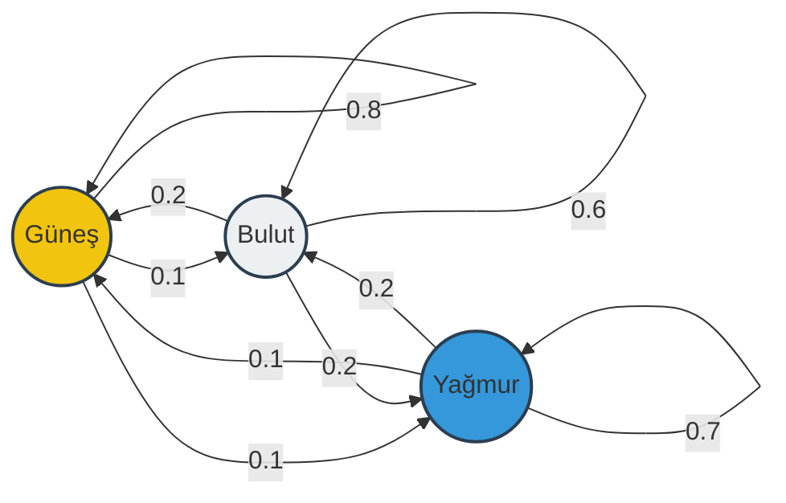
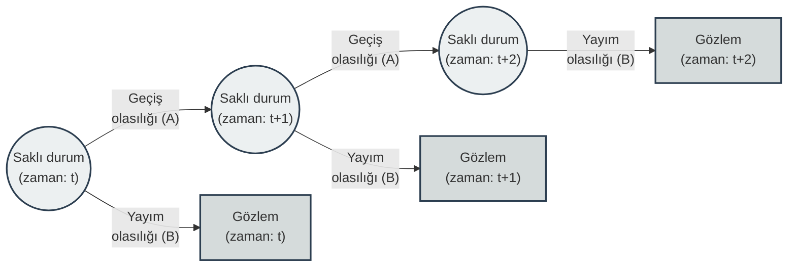
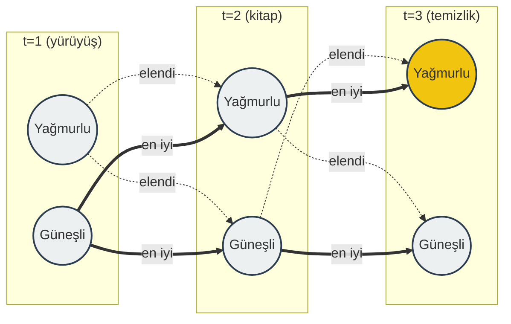

# Saklı Markov Modelleri (Hidden Markov Models, HMM)

## 1. Giriş: Saklı Durumlar ve Gözlemler

Sistemlerin ya da süreçlerin anlık durumları her zaman doğrudan ölçülemez. Çoğu zaman asıl ilgilenilen yapı, doğrudan gözlenebilen verilerin arkasında gizlidir. Doğal dil işlemede (Natural Language Processing, NLP) bir cümledeki sözcükler gözlenir; ama her sözcüğün isim mi, fiil mi, sıfat mı olduğu (sözcük türü) doğrudan görülmez.

Uzak bir şehirde yaşayan bir arkadaşla yalnızca mesajlaştığımızı düşünelim. Arkadaşımız her gün ne yaptığını yazar: Ya yürüyüşe çıkar, ya kitap okur ya da evde temizlik yapar. Biz ise o şehrin hava durumunu merak ediyoruz. Hava durumunu doğrudan göremeyiz; bu bizim için **saklı durumdur** (hidden state). İngilizce *state* sözcüğü Latince *status* (duruş, vaziyet) kökünden gelir ve sistemin içinde bulunduğu hâli anlatır.

Arkadaşımızın bildirdiği günlük etkinlikler ise **gözlemimizdir** (observation). *Observation* sözcüğü Latince *observare* (dikkatle bakmak, gözetlemek) fiiline dayanır. Elimizde yalnızca bu gözlemler vardır.

Arkadaşımızın güneşli günlerde yürüyüşe çıkma olasılığının, yağmurlu günlerde ise evde kitap okuma ya da temizlik yapma olasılığının yüksek olduğunu biliyoruz. Ayrıca o şehirde havanın bir günden ötekine genellikle aynı kaldığını da biliyoruz. Bu bilgilerle "Dün kitap okudu, bugün temizlik yaptı; demek ki dünden beri hava büyük olasılıkla yağmurlu" biçiminde geriye dönük bir çıkarım yaparız. Zihnimizde çalışan bu dizi modelinin matematiğe dökülmüş hâline **Saklı Markov Modeli** (Hidden Markov Model, HMM) denir.

Model adını Rus matematikçi Andrey Markov'dan (1856–1922) alır. Markov zincirlerinin temel ilkesi şudur: Sistemin bir sonraki durumunun olasılık dağılımı yalnızca şimdiki durumuna bağlıdır; geçmişin tamamını bilmek gerekmez. Buna **Markov özelliği** (Markov property) denir. HMM'yi anlamak için önce durumların doğrudan gözlendiği Markov zincirini ele alacağız (Bölüm 2), ardından durumları saklayıp yalnızca gözlemleri görünür bırakacağız (Bölüm 3).

---

## 2. Markov Zincirleri ve Markov Varsayımları

### 2.1 Durumlar ve Durum Dizileri

Bir sistemin bulunabileceği durumların kümesi $S = \{s_1, s_2, \ldots, s_{|S|}\}$ ile gösterilir. Sistem zaman içinde bu durumlar arasında geçiş yapar; $t$ anındaki durum $z_t$ ile gösterilir ve $T$ uzunluğundaki bir durum dizisi $\vec{z} = (z_1, \ldots, z_T) \in S^T$ olarak yazılır. Bu bölümde durumların **doğrudan gözlendiği** varsayılır.

Örneğin havanın alabileceği durumlar $S = \{\text{güneş}, \text{bulut}, \text{yağmur}\}$ olsun; $|S| = 3$'tür. Beş günlük ($T = 5$) bir gözlem dizisi şöyle olabilir: $(z_1, \ldots, z_5) = (\text{güneş}, \text{bulut}, \text{bulut}, \text{yağmur}, \text{bulut})$.

Hiçbir varsayım yapılmazsa $t$ anındaki hava, $1$'den $t-1$'e kadarki tüm geçmişin (hatta modellenmemiş birçok değişkenin) bir fonksiyonu olabilir. Bugünün havasını kestirmek için tüm geçmişi hesaba katmak zorunda olsaydık, hiçbir sistem bu hesabı yapamazdı. Zaman serileri hakkında hesaplanabilir biçimde akıl yürütmek için iki varsayım kullanılır.

### 2.2 Sınırlı Ufuk Varsayımı (Limited Horizon Assumption)

$t$ anında belirli bir durumda bulunma olasılığı yalnızca $t-1$ anındaki duruma bağlıdır:

$$P(z_t \mid z_{t-1}, z_{t-2}, \ldots, z_1) = P(z_t \mid z_{t-1})$$

Burada $P(X \mid Y)$, "$Y$ bilindiğinde $X$'in olasılığı" anlamına gelen **koşullu olasılıktır** (conditional probability). Varsayımın arkasındaki düşünce şudur: Şimdiki durum, geleceği kestirmek için geçmişin yeterli bir özetidir.

### 2.3 Durağanlık Varsayımı (Stationary Process Assumption)

Bir durumdan diğerine geçiş olasılıkları zamanla değişmez:

$$P(z_t \mid z_{t-1}) = P(z_2 \mid z_1), \qquad t \in \{2, \ldots, T\}$$

*Stationary* sözcüğü Latince *stationarius* (yerinde duran, sabit) kökünden gelir. "Güneşli bir günden sonra yağmur yağma olasılığı" bugün de on gün sonra da aynı kabul edilir.

### 2.4 Başlangıç Dağılımı ve Geçiş Matrisi

Bir Markov zinciri iki parametreyle tanımlanır:

- **Başlangıç olasılıkları** $\pi$: $\pi_i = P(z_1 = s_i)$, ilk andaki durumun dağılımı.
- **Geçiş matrisi** $A$ (transition matrix): $A_{ij} = P(z_t = s_j \mid z_{t-1} = s_i)$. Her satır bir olasılık dağılımı olduğundan satır toplamları 1'dir.

(Bazı kaynaklar, $\pi$'yi ayrı tutmak yerine sanal bir başlangıç durumu $s_0$ ekleyip $\pi$'yi $A$ matrisinin ilk satırı olarak yazar; bu durumda $A$, $(|S|+1) \times (|S|+1)$ boyutlu olur. Bu notta, HMM'de yaygın olan $\pi$ ve $A$'nın ayrı tutulduğu gösterim kullanılmaktadır.)

### 2.5 Örnek: Üç Durumlu Hava Modeli

Başlangıçta üç durumun eşit olasılıklı olduğunu varsayalım: $\pi = (1/3,\ 1/3,\ 1/3)$. Durumlar arasındaki geçişler şöyle olsun:

- Güneşli bir günden sonra yine güneşli olma olasılığı $0.8$, bulutlu olma olasılığı $0.1$, yağmurlu olma olasılığı $0.1$'dir.
- Bulutlu bir günden sonra güneşli olma olasılığı $0.2$, yine bulutlu olma olasılığı $0.6$, yağmurlu olma olasılığı $0.2$'dir.
- Yağmurlu bir günden sonra havanın açıp güneşli olma olasılığı $0.1$, bulutlu olma olasılığı $0.2$, yağmurlu kalma olasılığı $0.7$'dir.

| Mevcut durum \ Sonraki durum | Güneş | Bulut | Yağmur |
| :--- | :---: | :---: | :---: |
| **Güneş** | 0.8 | 0.1 | 0.1 |
| **Bulut** | 0.2 | 0.6 | 0.2 |
| **Yağmur** | 0.1 | 0.2 | 0.7 |



Matristeki büyük köşegen değerler, havanın kendi kendisiyle ilişkili (self-correlated) olduğu sezgisini yansıtır: Güneşliyse güneşli, yağmurluysa yağmurlu kalma eğilimindedir. Bu güçlü köşegen yapı birçok Markov modelinde görülür.

Bir durum dizisinin olasılığı, Markov varsayımları sayesinde basit bir çarpıma dönüşür. Örneğin $(\text{güneş}, \text{güneş}, \text{yağmur})$ dizisinin olasılığı:

$$P = \pi_{\text{güneş}} \cdot A_{\text{güneş},\text{güneş}} \cdot A_{\text{güneş},\text{yağmur}} = \tfrac{1}{3} \times 0.8 \times 0.1 \approx 0.0267$$

---

## 3. Saklı Markov Modelinin Parametreleri

Saklı Markov Modelinde durumlar artık doğrudan gözlenmez; her durum, kendisine özgü olasılıklarla bir **gözlem** üretir. Model üç parametreyle tanımlanır ve $\lambda = (A, B, \pi)$ biçiminde gösterilir.



**1. $A$ matrisi (geçiş olasılıkları, transition probabilities):** $A_{ij} = P(q_t = s_j \mid q_{t-1} = s_i)$; saklı durumlar arasındaki geçişler. "Bugün yağmurluysa yarın güneşli olma olasılığı nedir?" sorusunun karşılığıdır. (Bu bölümden itibaren saklı durumlar $q_t$, gözlemler $o_t$ ile gösterilmektedir.)

**2. $B$ matrisi (yayım olasılıkları, emission probabilities):** $B_{j}(o) = P(o_t = o \mid q_t = s_j)$; sistem $s_j$ durumundayken $o$ gözlemini üretme olasılığı. *Emission* sözcüğü Latince *emittere* (dışarı salmak, yaymak) kökünden gelir. "Hava yağmurluyken arkadaşımın kitap okuma olasılığı nedir?" sorusu bu matrisin bir elemanıdır.

**3. $\pi$ vektörü (başlangıç olasılıkları, initial probabilities):** $\pi_i = P(q_1 = s_i)$; gözlemlemeye başladığımız ilk andaki saklı durumun dağılımı.

### 3.1 Çözümlü Örnek İçin Model

Bölüm 1'deki arkadaş örneğini sayısallaştıralım. İki saklı durum (Yağmurlu, Güneşli) ve üç olası gözlem (yürüyüş, kitap, temizlik) vardır:

$$\pi = \begin{bmatrix} 0.6 & 0.4 \end{bmatrix} \quad (\text{Yağmurlu, Güneşli})$$

| $A$ (geçiş) | Yağmurlu | Güneşli |
| :--- | :---: | :---: |
| **Yağmurlu** | 0.7 | 0.3 |
| **Güneşli** | 0.4 | 0.6 |

| $B$ (yayım) | yürüyüş | kitap | temizlik |
| :--- | :---: | :---: | :---: |
| **Yağmurlu** | 0.1 | 0.4 | 0.5 |
| **Güneşli** | 0.6 | 0.3 | 0.1 |

Arkadaşımızın üç günlük mesajları sırasıyla şöyle olsun: $O = (\text{yürüyüş}, \text{kitap}, \text{temizlik})$.

---

## 4. HMM ile Çözülen Üç Temel Problem

* **Değerlendirme (evaluation):** Model $\lambda$ ve bir gözlem dizisi $O$ verildiğinde $P(O \mid \lambda)$ nedir? Yani bu model, bu gözlem dizisini hangi olasılıkla üretir? Birden fazla model arasından gözlemleri en iyi açıklayanı seçmek için kullanılır. **İleri algoritmasıyla** (forward algorithm) çözülür (Bölüm 5).
* **Kod çözme (decoding):** Gözlemleri üreten **en olası saklı durum dizisi** nedir? Bir cümledeki sözcüklerin türlerini sırayla belirlemek (part-of-speech tagging) bu problemin örneğidir. **Viterbi algoritmasıyla** çözülür (Bölüm 6).
* **Öğrenme (learning):** Elimizde yalnızca gözlemler varken $P(O \mid \lambda)$'yı en büyük yapan $A$, $B$ ve $\pi$ parametreleri nelerdir? **Baum–Welch algoritmasıyla** çözülür (Bölüm 7).

Üç problemin ortak zorluğu şudur: $N$ saklı durum ve $T$ uzunluğunda bir gözlem dizisi için olası durum dizisi sayısı $N^T$'dir. Örneğin 3 durum ve 20 gözlem için $3^{20} \approx 3.5 \times 10^9$ dizi vardır; tüm dizileri tek tek hesaplamak pratik değildir. İleri ve Viterbi algoritmaları **dinamik programlamayla** bu maliyeti $O(N^2 T)$'ye indirir.

---

## 5. Değerlendirme: İleri Algoritması (Forward Algorithm)

### 5.1 Fikir

$P(O \mid \lambda)$, tüm olası durum dizileri üzerinden toplanarak bulunur. İleri algoritması bu toplamı her adımda bir öncekinin üzerine inşa ederek hesaplar. **İleri değişkeni** şöyle tanımlanır:

$$\alpha_t(j) = P(o_1, o_2, \ldots, o_t,\ q_t = s_j \mid \lambda)$$

yani ilk $t$ gözlemin görülmesi **ve** $t$ anında $s_j$ durumunda bulunulması olasılığı.

### 5.2 Adımlar

**Başlatma** ($t = 1$):

$$\alpha_1(j) = \pi_j \, B_j(o_1)$$

**Özyineleme** ($t = 2, \ldots, T$): $s_j$ durumuna önceki her durumdan gelinebilir; bu yolların olasılıkları **toplanır**:

$$\alpha_t(j) = \left[ \sum_{i=1}^{N} \alpha_{t-1}(i)\, A_{ij} \right] B_j(o_t)$$

**Sonlandırma:**

$$P(O \mid \lambda) = \sum_{j=1}^{N} \alpha_T(j)$$

### 5.3 Çözümlü Örnek

$O = (\text{yürüyüş}, \text{kitap}, \text{temizlik})$ için (Y: Yağmurlu, G: Güneşli):

| $t$ | Gözlem | $\alpha_t(\text{Y})$ | $\alpha_t(\text{G})$ |
| :---: | :--- | :--- | :--- |
| 1 | yürüyüş | $0.6 \times 0.1 = 0.06$ | $0.4 \times 0.6 = 0.24$ |
| 2 | kitap | $(0.06 \times 0.7 + 0.24 \times 0.4) \times 0.4 = 0.0552$ | $(0.06 \times 0.3 + 0.24 \times 0.6) \times 0.3 = 0.0486$ |
| 3 | temizlik | $(0.0552 \times 0.7 + 0.0486 \times 0.4) \times 0.5 = 0.02904$ | $(0.0552 \times 0.3 + 0.0486 \times 0.6) \times 0.1 = 0.004572$ |

$$P(O \mid \lambda) = 0.02904 + 0.004572 = 0.033612$$

Bu model, bu üç günlük mesaj dizisini yaklaşık $0.0336$ olasılıkla üretir. Tek başına bu sayı küçük görünebilir; değeri, aynı gözlemler için başka bir modelin vereceği olasılıkla karşılaştırıldığında anlam kazanır.

---

## 6. Kod Çözme: Viterbi Algoritması ve Dinamik Programlama

### 6.1 Sezgi: En Kısa Yolu Bulan Kurye

Viterbi algoritması (Andrew Viterbi, 1967) **dinamik programlama** (dynamic programming) üzerine kuruludur. Dinamik programlama, büyük bir problemi örtüşen alt problemlere böler, her alt problemi bir kez çözüp sonucunu saklar ve büyük problemin çözümünü bu saklı sonuçlardan kurar. Yöntem, bir problemin en iyi çözümünün alt problemlerin en iyi çözümlerinden oluştuğu (en iyi alt yapı, optimal substructure) durumlarda kullanılabilir. Adı, Richard Bellman'ın 1950'lerde çok aşamalı ve zamana bağlı karar problemleri için kullandığı terimden gelir; buradaki "dinamik" sözcüğü (Yunanca *dynamis*, güç) sürecin aşama aşama ilerlemesini anlatır.

Bu fikri somutlaştırmak için bir kuryeyi düşünelim. Kurye, yan yana dizilmiş mahalleleri sırayla geçerek bir hedefe ulaşacaktır; her mahallede birkaç kavşak vardır ve en kısa süreli rotayı arıyordur. Kurye, rotayı tüm olasılıklarıyla baştan sona düşünmek yerine işi küçük adımlara böler:

1. **Birinci mahalle:** Başlangıç noktasından birinci mahalledeki üç kavşağa (A, B, C) gitme süreleri hesaplanıp not edilir: A'ya 10 dk, B'ye 15 dk, C'ye 12 dk.
2. **İkinci mahalle:** İkinci mahalledeki "Merkez Kavşağı"na A, B ve C'den gelinebilir. Üç hesap yapılır:
    * A'ya 10 dk; A'dan Merkez'e 8 dk. Toplam **18 dk**.
    * B'ye 15 dk; B'den Merkez'e 2 dk. Toplam **17 dk** (en kısa).
    * C'ye 12 dk; C'den Merkez'e 10 dk. Toplam **22 dk**.
3. **Eleme:** Merkez Kavşağı'na ulaşmanın en kısa yolu 17 dk ile B üzerinden geçendir. Rota ileride Merkez Kavşağı'ndan geçecekse, B üzerinden gelmek A ya da C üzerinden gelmekten her zaman daha kısadır; bu nedenle A ve C'den gelen yollar Merkez Kavşağı için elenir ve yalnızca "Merkez'e en iyi B'den gelinir, 17 dk" bilgisi saklanır.
4. **Sonraki mahalleler:** Aynı işlem her mahalledeki her kavşak için yapılır. Hedefe ulaşıldığında saklanan "nereden gelindi" bilgileri geriye doğru izlenerek en iyi rota bulunur.

Viterbi algoritması aynı mantığı olasılıklarla uygular: Sürelerin toplamı yerine olasılıkların **çarpımı**, en küçük yerine **en büyük** değer aranır. (Olasılıkların negatif logaritması alındığında çarpım toplama, en büyük de en küçüğe dönüşür; böylece iki problem birebir aynı biçime gelir.)

### 6.2 Viterbi Değişkeni ve Adımlar

**Viterbi değişkeni** $\delta_t(j)$, ilk $t$ gözlemi üreten ve $t$ anında $s_j$ durumunda biten **en olası** durum dizisinin olasılığıdır:

$$\delta_t(j) = \max_{q_1, \ldots, q_{t-1}} P(q_1, \ldots, q_{t-1},\ q_t = s_j,\ o_1, \ldots, o_t \mid \lambda)$$

$\psi_t(j)$ ise bu en olası dizide $t-1$ anında bulunulan durumu, yani **geri işaretçiyi** (backpointer) saklar.

**Başlatma** ($t = 1$):

$$\delta_1(j) = \pi_j \, B_j(o_1), \qquad \psi_1(j) = 0$$

**Özyineleme** ($t = 2, \ldots, T$):

$$\delta_t(j) = \max_{i} \left[ \delta_{t-1}(i)\, A_{ij} \right] B_j(o_t), \qquad \psi_t(j) = \arg\max_{i} \left[ \delta_{t-1}(i)\, A_{ij} \right]$$

İleri algoritmasından tek fark, önceki durumlar üzerindeki **toplamın** yerini **en büyük değerin** almasıdır. Formüldeki terimler:

* $\delta_{t-1}(i)$: Bir önceki anda $s_i$ durumunda biten en olası dizinin olasılığı (kuryenin önceki kavşağa ulaşma süresine karşılık gelir).
* $A_{ij}$: $s_i$'den $s_j$'ye geçiş olasılığı (iki kavşak arasındaki yol).
* $B_j(o_t)$: $s_j$ durumunun $t$ anındaki gözlemi üretme olasılığı.

**Sonlandırma:**

$$P^{*} = \max_{j} \delta_T(j), \qquad q_T^{*} = \arg\max_{j} \delta_T(j)$$

**Geriye iz sürme (backtracking):** $t = T-1, \ldots, 1$ için

$$q_t^{*} = \psi_{t+1}(q_{t+1}^{*})$$

Bu işlem bittiğinde, gözlem dizisini üreten en olası saklı durum dizisi $q_1^{*}, \ldots, q_T^{*}$ elde edilir. Algoritma, model verildiğinde bu dizinin gerçekten en olası dizi olduğunu garanti eder.

### 6.3 Çözümlü Örnek

Aynı model ve $O = (\text{yürüyüş}, \text{kitap}, \text{temizlik})$ için:

| $t$ | Gözlem | $\delta_t(\text{Y})$ | $\psi_t(\text{Y})$ | $\delta_t(\text{G})$ | $\psi_t(\text{G})$ |
| :---: | :--- | :--- | :---: | :--- | :---: |
| 1 | yürüyüş | $0.6 \times 0.1 = 0.06$ | — | $0.4 \times 0.6 = 0.24$ | — |
| 2 | kitap | $\max(0.06 \times 0.7,\ 0.24 \times 0.4) \times 0.4 = 0.096 \times 0.4 = 0.0384$ | G | $\max(0.06 \times 0.3,\ 0.24 \times 0.6) \times 0.3 = 0.144 \times 0.3 = 0.0432$ | G |
| 3 | temizlik | $\max(0.0384 \times 0.7,\ 0.0432 \times 0.4) \times 0.5 = 0.02688 \times 0.5 = 0.01344$ | Y | $\max(0.0384 \times 0.3,\ 0.0432 \times 0.6) \times 0.1 = 0.02592 \times 0.1 = 0.002592$ | G |

**Sonlandırma:** $\max(0.01344,\ 0.002592) = 0.01344$; son durum **Yağmurlu**.

**Geriye iz sürme:** $\psi_3(\text{Y}) = \text{Y}$, yani 2. gün Yağmurlu; $\psi_2(\text{Y}) = \text{G}$, yani 1. gün Güneşli.

**En olası saklı durum dizisi:** Güneşli → Yağmurlu → Yağmurlu. Bu sonuç Bölüm 1'deki sezgisel çıkarımla örtüşür: Yürüyüşe çıkılan gün güneşli, kitap okunan ve temizlik yapılan günler yağmurludur. Bu dizinin gözlemler verildiğindeki koşullu olasılığı $0.01344 / 0.033612 \approx 0.40$'tır; yani model bu yorumu en olası bulmakla birlikte başka dizilerin de toplamda azımsanmayacak bir olasılığı vardır.

Bu hesabın zaman içindeki akışı genellikle **kafes** (trellis) diyagramıyla gösterilir. Aşağıdaki diyagramda kalın oklar her durum için seçilen en iyi önceki durumu (geri işaretçileri), kesikli oklar elenen geçişleri gösterir; vurgulanan düğüm, geriye iz sürmenin başladığı son durumdur.



### 6.4 Python ile Doğrulama

```python
import numpy as np

durumlar   = ['Yağmurlu', 'Güneşli']
gozlemler  = ['yürüyüş', 'kitap', 'temizlik']
pi = np.array([0.6, 0.4])
A  = np.array([[0.7, 0.3],
               [0.4, 0.6]])
B  = np.array([[0.1, 0.4, 0.5],
               [0.6, 0.3, 0.1]])
O  = [0, 1, 2]                     # yürüyüş, kitap, temizlik

# İleri algoritması
alpha = pi * B[:, O[0]]
for o in O[1:]:
    alpha = (alpha @ A) * B[:, o]
print("P(O | λ) =", round(alpha.sum(), 6))

# Viterbi algoritması
delta = pi * B[:, O[0]]
geri_isaretci = []
for o in O[1:]:
    aday = delta[:, None] * A          # aday[i, j] = delta(i) * A(i, j)
    geri_isaretci.append(aday.argmax(axis=0))
    delta = aday.max(axis=0) * B[:, o]

yol = [int(delta.argmax())]
for psi in reversed(geri_isaretci):
    yol.insert(0, int(psi[yol[0]]))
print("En olası dizi:", [durumlar[i] for i in yol], "olasılık =", round(delta.max(), 6))
```

Çıktı:

```text
P(O | λ) = 0.033612
En olası dizi: ['Güneşli', 'Yağmurlu', 'Yağmurlu'] olasılık = 0.01344
```

Uzun gözlem dizilerinde olasılıkların çarpımı çok küçülür ve bilgisayarın kayan noktalı sayı aralığının altına düşebilir (underflow). Uygulamada bu nedenle Viterbi algoritması olasılıkların logaritmalarıyla (çarpımlar yerine toplamlarla), ileri algoritması ise her adımda ölçeklendirilerek çalıştırılır.

---

## 7. Öğrenme: Baum–Welch Algoritması

Model parametreleri bilinmediğinde, yalnızca gözlem dizilerinden kestirilmeleri gerekir. **Baum–Welch algoritması**, beklenti–enbüyütme (expectation–maximization, EM) yönteminin HMM'ye uygulanmış biçimidir. İleri değişkenine ek olarak, $t$ anında $s_i$ durumunda bulunulduğunda kalan gözlemlerin görülme olasılığını veren bir **geri değişkeni** (backward variable) $\beta_t(i)$ kullanır. Her yinelemede:

1. **Beklenti adımı (E):** Mevcut parametrelerle, her anda her durumda bulunma ve her durum çiftinin ardışık görülme olasılıkları $\alpha$ ve $\beta$ yardımıyla hesaplanır.
2. **Enbüyütme adımı (M):** $\pi$, $A$ ve $B$ bu beklenen sayımlara göre yeniden kestirilir.

Her yinelemede $P(O \mid \lambda)$ azalmaz; algoritma yerel bir en büyük değere yakınsar. Sonuç başlangıç değerlerine bağlı olabileceğinden farklı başlangıçlarla denemek yararlıdır.

---

## 8. Uygulama Alanları

Saklı Markov Modelleri; konuşma tanıma, sözcük türü etiketleme gibi doğal dil işleme görevleri, biyoinformatikte gen ve protein dizilerinin çözümlenmesi, finansal zaman serilerinde piyasa rejimlerinin belirlenmesi ve algılayıcı verilerinden etkinlik tanıma gibi birçok alanda kullanılır. Bu alanların ortak noktası, gürültülü ve belirsiz gözlemlerin arkasında, zaman içinde değişen saklı bir yapının bulunmasıdır.

---

## Kaynaklar

- Rabiner, L. R. (1989). A tutorial on hidden Markov models and selected applications in speech recognition. *Proceedings of the IEEE*, 77(2), 257–286.
- Ramage, D. (2007). *Hidden Markov Models Fundamentals*. Stanford CS229 ders notu.
- Jurafsky, D. ve Martin, J. H. *Speech and Language Processing* (3. baskı taslağı), Ek A: Hidden Markov Models.
- Viterbi, A. J. (1967). Error bounds for convolutional codes and an asymptotically optimum decoding algorithm. *IEEE Transactions on Information Theory*, 13(2), 260–269.
