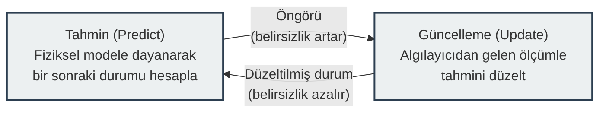

# Kalman Filtreleri (Kalman Filters)

## 1. Giriş

### 1.1 Kalman Filtresi Nedir ve Neden Önemlidir?

Algılayıcı (sensor) verilerini okumak ve bu veriler üzerinden anlamlı çıkarımlar yapmak mühendisliğin temel meselelerinden biridir. Ancak gerçek dünyada hiçbir algılayıcı kusursuz çalışmaz. Okunan her değere fiziksel çevreden, elektronik bileşenlerden veya veri iletiminden kaynaklanan bir miktar hata karışır; bu hataya **gürültü** (noise) denir. İngilizce *noise* sözcüğü Eski Fransızcadan gelir; kökeninin Latince *nausea* (deniz tutması, rahatsızlık) olduğu düşünülür.

**Kalman filtresi** (Kalman filter), dolaylı ve gürültülü ölçümlerden bir sistemin durumunu tahmin etmek için kullanılan özyinelemeli (recursive) bir kestirim algoritmasıdır (estimation algorithm). Adını Macar asıllı Amerikalı mühendis ve matematikçi Rudolf E. Kálmán'dan (1960) alır. Gürültülü ve eksik verilerle başa çıkabilmesi, onu doğrudan ölçümün imkânsız ya da güvenilmez olduğu birçok alanda vazgeçilmez kılar.

Kalman filtresi, sinyali doğrudan süzerek gürültüyü azaltan geleneksel filtrelerden farklı çalışır. Sistemin zaman içindeki değişimini tanımlayan bir matematiksel modelden yararlanır ve bu modelin öngörüsünü ölçümlerle birleştirir. Böylece mevcut durumu kestirebilir, gelecekteki durumu öngörebilir ve (yumuşatma, smoothing, sürümleriyle) geçmişteki durumları düzeltebilir. Bu çok yönlülük onu hedef takibi, seyrüsefer (navigasyon) ve denetim uygulamalarının temel bileşeni hâline getirmiştir.

"En iyi" sözcüğü burada belirli bir anlam taşır: Sistem doğrusal, gürültüler ise sıfır ortalamalı Gauss gürültüsü olduğunda Kalman filtresi, kestirim hatasının ortalama karesini en aza indiren (minimum mean square error, MMSE) kestiricidir. Gürültüler Gauss dağılımlı değilse, doğrusal kestiriciler arasında en iyisidir. Özyinelemeli yapısı sayesinde yalnızca son kestirimi ve onun belirsizliğini saklar; tüm ölçüm geçmişini tutmak gerekmez. Bu özellik onu gerçek zamanlı uygulamalara uygun kılar.

### 1.2 Sezgisel Bir Örnek: Tünelde Konum Bulma

Arabayla uzun bir yolculuğa çıkıldığını ve telefonun GPS'inin (Global Positioning System, küresel konum belirleme sistemi) kullanıldığını düşünelim. GPS uydulardan aldığı sinyallerle konumu gösterir; ancak birkaç metrelik bir hata payı, yani gürültüsü vardır. Araç uzun bir tünele girdiğinde GPS sinyali kesilir, buna rağmen haritadaki araç simgesi ilerlemeye devam eder. Telefon sinyal almadığı hâlde konumu nasıl bilir?

Telefon, tünele girmeden önceki son hızı ve yönü bilmektedir. Bu bilgilerle tünel içindeki konumu **tahmin eder** (predict). Ancak zaman geçtikçe bu tahminin belirsizliği artar; araç tünelde yavaşlamış ya da şerit değiştirmiş olabilir. Tünelden çıkıldığında GPS sinyali geri gelir ve yeni bir **ölçüm** (measurement) alınır. Sistem tahminini bu ölçümle karşılaştırarak konumu **günceller** (update). Hangi bilgiye ne kadar güvenileceğini, ikisinin belirsizlikleri belirler.

Kalman filtresi tam olarak bu iki adımlı döngüyle çalışır:



### 1.3 Gürültülü Ölçümler ve Belirsiz Sistemler

Gerçek dünya ölçümleri gürültülüdür. Algılayıcıların sınırlamaları ve çevresel etkenler **ölçüm gürültüsüne** (measurement noise) yol açar; örneğin GPS ölçümleri atmosferik etkilerden ve sinyal yansımalarından etkilenir. Ayrıca sistemlerin kendisi de matematiksel modellerin tam olarak yakalayamadığı bozucu etkilere maruz kalır; bir hava aracının hareketini rüzgâr ve türbülans etkiler. Modelin hesaba katamadığı bu etkilere **süreç gürültüsü** (process noise) denir.

Hem ölçümlerdeki hem de modeldeki bu kusurlar, iki bilgi kaynağının belirsizliklerini birlikte hesaba katan bir kestirim yöntemini gerekli kılar. Kalman filtresinin temel fikri, modele dayalı **önsel bilgiyi** (tahmin) yeni **kanıtla** (ölçüm), güvenilirliklerine göre ağırlıklandırarak birleştirmektir.

---

## 2. Temel: Durum Uzayı Gösterimi (State-Space Representation)

### 2.1 Sistemin Durumu

Bir sistemin **durumu** (state), belirli bir andaki koşulunu tanımlayan değişkenler kümesidir; örneğin bir nesnenin konumu, hızı ve ivmesi. *State* sözcüğü Latince *status* (duruş, vaziyet) kökünden gelir. Durum genellikle bir **durum vektörü** (state vector) $x_k$ ile gösterilir; $k$ ayrık zaman adımıdır. Durum değişkenleri, sistemin problemle ilgili davranışını tanımlamaya yetecek biçimde seçilmelidir.

### 2.2 Durum Denklemi: Sistem Dinamiğinin Modellenmesi

Durum denklemi, sistemin durumunun bir adımdan sonrakine nasıl değiştiğini tanımlar:

$$x_k = F_k\, x_{k-1} + B_k\, u_k + w_k$$

- $x_k$: $k$ anındaki durum vektörü.
- $F_k$ (durum geçiş matrisi, state transition matrix): Önceki durumun, dış etki olmadan yeni duruma nasıl dönüştüğünü tanımlar. Bazı kaynaklarda $\Phi$ ya da $A$ ile gösterilir.
- $u_k$ ve $B_k$ (denetim girdisi ve denetim girdi matrisi, control input matrix): Sisteme dışarıdan verilen komutların (örneğin gaza ya da frene basma) durumu nasıl etkilediğini tanımlar. Denetim girdisi yoksa bu terim düşer.
- $w_k$ (süreç gürültüsü): Modelin hesaba katamadığı etkiler.

```math
\underbrace{x_k}_{\substack{\text{yeni}\\\text{durum}}} = \overbrace{F_k\, x_{k-1}}^{\substack{\text{önceki durumun}\\\text{dinamikle dönüşümü}}} + \underbrace{B_k\, u_k}_{\substack{\text{denetim girdisinin}\\\text{etkisi}}} + \overbrace{w_k}^{\substack{\text{süreç}\\\text{gürültüsü}}}
```

**Ne anlatıyor?** Sistemin yeni durumu üç katkının toplamıdır: önceki durumun sistem dinamiğine göre dönüşmesi, dışarıdan verilen komutların etkisi ve modelin açıklayamadığı rastgele etkiler. Böylece durum denklemi, bilinen fiziksel ilişkiler ile bilinmeyen bozucuları tek bir bağıntıda birleştirir.

### 2.3 Ölçüm Denklemi: Durumların Gözlemlerle İlişkilendirilmesi

$$z_k = H_k\, x_k + v_k$$

- $z_k$: $k$ anında algılayıcılardan elde edilen ölçüm vektörü.
- $H_k$ (ölçüm matrisi, measurement matrix): Durumu, algılayıcının ölçebildiği büyüklüklere dönüştürür. Örneğin yalnızca konumu ölçebilen, hızı ölçemeyen bir algılayıcının yapısını yansıtır.
- $v_k$ (ölçüm gürültüsü): Algılayıcının okuma hataları.

```math
\underbrace{z_k}_{\text{ölçüm}} = \overbrace{H_k\, x_k}^{\substack{\text{durumdan beklenen}\\\text{ölçüm}}} + \underbrace{v_k}_{\substack{\text{ölçüm}\\\text{gürültüsü}}}
```

**Ne anlatıyor?** Algılayıcının okuduğu değer, gerçek durumun ölçülebilen kısmına okuma hatasının eklenmesiyle oluşur. $H_k$ matrisi, durum vektöründen algılayıcının görebildiği bileşenleri seçer ya da onları algılayıcının birimine dönüştürür.

### 2.4 Süreç ve Ölçüm Gürültüsü

Süreç gürültüsü $w_k$'nin sıfır ortalamalı ve $Q_k$ kovaryans matrisine sahip beyaz Gauss gürültüsü (white Gaussian noise) olduğu varsayılır:

$$Q_k = E[w_k w_k^{T}]$$

Burada $E[\cdot]$ beklenen değeri (ortalamayı), $^{T}$ ise matrisin devriğini (transpose, satır ve sütunlarının yer değiştirmesi) gösterir. $Q$ sistem dinamiğindeki belirsizliği nicelendirir: Köşegen elemanlar her durum değişkenindeki gürültünün varyansını, köşegen dışı elemanlar ise değişkenler arasındaki kovaryansı gösterir.

```math
\underbrace{Q_k}_{\substack{\text{süreç gürültüsü}\\\text{kovaryansı}}} = \overbrace{E}^{\substack{\text{beklenen}\\\text{değer}}}\big[\underbrace{w_k\, w_k^{T}}_{\substack{\text{gürültünün kendisiyle}\\\text{dış çarpımı}}}\big]
```

**Ne anlatıyor?** Sıfır ortalamalı süreç gürültüsünün kendisiyle dış çarpımının beklenen değeri, gürültünün her bileşendeki varyansını ve bileşenler arasındaki kovaryansı tek bir matriste toplar. $Q_k$ büyüdükçe modelin bir adımlık öngörüsüne daha az güvenilir.

Benzer biçimde ölçüm gürültüsü $v_k$'nin de sıfır ortalamalı ve $R_k$ kovaryanslı beyaz Gauss gürültüsü olduğu varsayılır:

$$R_k = E[v_k v_k^{T}]$$

```math
\underbrace{R_k}_{\substack{\text{ölçüm gürültüsü}\\\text{kovaryansı}}} = \overbrace{E}^{\substack{\text{beklenen}\\\text{değer}}}\big[\underbrace{v_k\, v_k^{T}}_{\substack{\text{ölçüm hatasının}\\\text{kendisiyle dış çarpımı}}}\big]
```

**Ne anlatıyor?** $Q_k$ ile aynı yapıdaki bu matris, her ölçüm bileşenindeki hata varyansını ve bileşenlerin hataları arasındaki kovaryansı verir; algılayıcının ne kadar gürültülü olduğunu sayısal olarak tanımlar.

$R$ ölçümlerdeki belirsizliği nicelendirir. $w_k$ ile $v_k$'nin birbirinden ve başlangıç durumundan bağımsız olduğu varsayılır; bu varsayım filtrenin türetilmesini basitleştirir.

---

## 3. Kalman Filtresi Algoritması

### 3.1 Gösterim

- $\hat{x}$ (şapkalı $x$): Gerçek durumun kendisi değil, **kestirimi** (estimate).
- $\hat{x}_{k|k-1}$: $k-1$ anına kadarki ölçümlerle $k$ anı için yapılan kestirim (**önsel**, a priori; ölçüm henüz kullanılmamış).
- $\hat{x}_{k|k}$: $k$ anındaki ölçüm de kullanılarak yapılan kestirim (**sonsal**, a posteriori).
- $P$: Kestirim hatasının kovaryans matrisi; kestirime ne kadar güvenilebileceğini gösterir. $P$ büyüdükçe belirsizlik artar.

### 3.2 Başlatma (Initialization)

Algoritma, başlangıç durumu kestirimi $\hat{x}_{0|0}$ ve kovaryansı $P_{0|0}$ ile başlar. Bu değerler başlangıç koşulu hakkındaki en iyi bilgiyi ve buna ilişkin belirsizliği temsil eder. Ön bilgi yoksa makul bir tahmin ve büyük bir başlangıç belirsizliği kullanılır; bazı uygulamalarda başlangıç durumu ilk ölçümle başlatılır ve $P_{0|0}$ ilk ölçümün gürültüsüne göre ayarlanır.

### 3.3 Tahmin Adımı (Predict)

Model kullanılarak durum ve belirsizlik zamanda bir adım ileriye taşınır:

$$\hat{x}_{k|k-1} = F_k\, \hat{x}_{k-1|k-1} + B_k\, u_k$$

```math
\underbrace{\hat{x}_{k|k-1}}_{\substack{\text{önsel kestirim}\\\text{(tahmin)}}} = \overbrace{F_k\, \hat{x}_{k-1|k-1}}^{\substack{\text{önceki sonsal kestirimin}\\\text{bir adım ileri taşınması}}} + \underbrace{B_k\, u_k}_{\substack{\text{denetim girdisinin}\\\text{etkisi}}}
```

**Ne anlatıyor?** Bir önceki adımın en iyi kestirimi, durum denklemi gürültü terimi olmadan işletilerek bir sonraki an için öngörülür. Gürültünün ortalaması sıfır kabul edildiğinden $w_k$ bu öngörüde yer almaz.

$$P_{k|k-1} = F_k\, P_{k-1|k-1}\, F_k^{T} + Q_k$$

```math
\underbrace{P_{k|k-1}}_{\substack{\text{önsel}\\\text{belirsizlik}}} = \overbrace{F_k\, P_{k-1|k-1}\, F_k^{T}}^{\substack{\text{önceki belirsizliğin}\\\text{dinamikle taşınması}}} + \underbrace{Q_k}_{\substack{\text{eklenen süreç}\\\text{belirsizliği}}}
```

**Ne anlatıyor?** Önceki kestirimin hata kovaryansı sistem dinamiğinden geçirilerek yeni ana aktarılır ve üzerine modelin kusurlarından kaynaklanan belirsizlik eklenir. Bir kovaryans matrisi bir doğrusal dönüşümden geçirilirken dönüşüm matrisiyle iki yandan çarpılır; $F_k P F_k^{T}$ biçimi buradan gelir.

İkinci denklemdeki $Q_k$ terimi, modelin kusursuz olmadığını ve dış etkilerin sistemi bozabileceğini yansıtır: Ölçüm alınmadan geçen her adımda belirsizlik artar. Bu adımda algılayıcıdan hiç veri kullanılmaz; yalnızca sistemin kendi dinamiği işletilir.

### 3.4 Güncelleme Adımı (Update)

Yeni ölçüm $z_k$ hesaba katılır.

**Yenilik (innovation, artık):** Ölçüm ile tahmine göre beklenen ölçüm arasındaki fark ve bu farkın kovaryansı:

$$y_k = z_k - H_k\, \hat{x}_{k|k-1}, \qquad S_k = H_k\, P_{k|k-1}\, H_k^{T} + R_k$$

```math
\underbrace{y_k}_{\text{yenilik}} = \overbrace{z_k}^{\substack{\text{gerçek}\\\text{ölçüm}}} - \overbrace{H_k\, \hat{x}_{k|k-1}}^{\substack{\text{beklenen}\\\text{ölçüm}}}, \qquad \underbrace{S_k}_{\substack{\text{yeniliğin}\\\text{kovaryansı}}} = \overbrace{H_k\, P_{k|k-1}\, H_k^{T}}^{\substack{\text{tahmin belirsizliğinin}\\\text{ölçüm uzayındaki karşılığı}}} + \underbrace{R_k}_{\substack{\text{ölçüm}\\\text{belirsizliği}}}
```

**Ne anlatıyor?** Yenilik, algılayıcının gördüğü değer ile tahmine göre görülmesi beklenen değer arasındaki farktır ve ölçümün getirdiği yeni bilgiyi taşır. Bu farkın beklenen büyüklüğü iki kaynaktan gelir: tahmindeki belirsizlik ve ölçümdeki gürültü.

**Kalman kazancı (Kalman gain):** Ölçüme mi yoksa tahmine mi ne kadar güvenileceğini belirleyen ağırlık matrisidir:

$$K_k = P_{k|k-1}\, H_k^{T}\, S_k^{-1}$$

Burada $^{-1}$ matrisin tersini gösterir; skaler durumda bölmeye karşılık gelir.

```math
\underbrace{K_k}_{\substack{\text{Kalman}\\\text{kazancı}}} = \overbrace{P_{k|k-1}\, H_k^{T}}^{\substack{\text{tahminin}\\\text{belirsizliği}}}\; \underbrace{S_k^{-1}}_{\substack{\text{toplam belirsizliğe}\\\text{bölme}}}
```

**Ne anlatıyor?** Kazanç, tahminin belirsizliğinin yeniliğin toplam belirsizliğine oranıdır. Tahmin ölçüme göre ne kadar belirsizse kazanç o kadar büyük olur ve kestirim ölçüme doğru o kadar çekilir.

**Durum ve kovaryansın güncellenmesi:**

$$\hat{x}_{k|k} = \hat{x}_{k|k-1} + K_k\, y_k$$

```math
\underbrace{\hat{x}_{k|k}}_{\substack{\text{sonsal}\\\text{kestirim}}} = \overbrace{\hat{x}_{k|k-1}}^{\substack{\text{önsel}\\\text{kestirim}}} + \underbrace{K_k}_{\text{kazanç}}\, \overbrace{y_k}^{\text{yenilik}}
```

**Ne anlatıyor?** Güncellenmiş kestirim, tahmine yeniliğin kazançla ağırlıklandırılmış bir kısmı eklenerek elde edilir. Ölçüm tahminle örtüşüyorsa yenilik sıfıra yakındır ve tahmin pek değişmez.

$$P_{k|k} = (I - K_k H_k)\, P_{k|k-1}$$

$I$ birim matristir (identity matrix). Ölçüm kullanıldıktan sonra belirsizlik azalır; azalmanın miktarı Kalman kazancına bağlıdır.

```math
\underbrace{P_{k|k}}_{\substack{\text{sonsal}\\\text{belirsizlik}}} = \overbrace{(I - K_k H_k)}^{\substack{\text{ölçümle sağlanan}\\\text{küçültme}}}\, \underbrace{P_{k|k-1}}_{\substack{\text{önsel}\\\text{belirsizlik}}}
```

**Ne anlatıyor?** Ölçüm kullanıldıktan sonra kalan belirsizlik, önsel belirsizlikten kazançla orantılı bir kısmın çıkarılmasıyla bulunur. Kazanç sıfırsa belirsizlik değişmez; kazanç büyüdükçe belirsizlik daha çok azalır.

### 3.5 Kalman Kazancının Sezgisi: Tek Boyutlu Durum

Durum tek bir sayı ve $H = 1$ olduğunda kazanç şu basit biçimi alır:

$$K = \frac{P_{k|k-1}}{P_{k|k-1} + R}, \qquad \hat{x}_{k|k} = (1-K)\,\hat{x}_{k|k-1} + K\, z_k$$

```math
\underbrace{K}_{\text{kazanç}} = \frac{\overbrace{P_{k|k-1}}^{\substack{\text{tahminin}\\\text{varyansı}}}}{\underbrace{P_{k|k-1} + R}_{\substack{\text{toplam}\\\text{varyans}}}}, \qquad \hat{x}_{k|k} = \underbrace{(1-K)\,\hat{x}_{k|k-1}}_{\substack{\text{tahminin}\\\text{ağırlıklı payı}}} + \overbrace{K\, z_k}^{\substack{\text{ölçümün}\\\text{ağırlıklı payı}}}
```

**Ne anlatıyor?** Tek boyutta kazanç, tahminin varyansının tahmin ve ölçüm varyanslarının toplamına oranıdır; bu nedenle 0 ile 1 arasında kalır. Yeni kestirimde tahmin ve ölçümün ağırlıklarının toplamı 1 olduğundan sonuç her zaman ikisinin arasında yer alır.

Güncellenmiş kestirim, tahmin ile ölçümün **ağırlıklı ortalamasıdır**. Ölçüm gürültüsü küçükse ($R \to 0$) $K \to 1$ olur ve filtre ölçüme güvenir. Tahminin belirsizliği küçükse ($P_{k|k-1} \to 0$) $K \to 0$ olur ve filtre tahmine güvenir. Süreç gürültüsü $Q$ büyüdükçe $P_{k|k-1}$ büyüdüğü için kazanç da büyür.

"En iyi" kazanç, güncellenmiş kestirimin hata kovaryansını (sonsal kovaryans) en aza indirecek biçimde seçilir; yukarıdaki formül bu eniyileme probleminin çözümüdür. Yüksek kazanç filtreyi yeni ölçümlere duyarlı ama gürültülü yapar; düşük kazanç daha yumuşak ama değişikliklere geç tepki veren bir kestirim üretir. $Q$ ile $R$'nin göreli büyüklüğü bu dengeyi belirler; bu nedenle iki matrisin doğru seçilmesi önemlidir (Bölüm 8).

### 3.6 Olasılıksal Yorum

Tahmin adımı, durumun Gauss dağılımını zamanda ileriye taşır; dağılım genişler (belirsizlik artar). Güncelleme adımı, bu dağılımı ölçümün Gauss dağılımıyla birleştirir ve daha dar bir dağılım elde edilir. Kalman filtresi, bu nedenle Gauss dağılımları için özyinelemeli bir **Bayes kestiricisi** olarak da yorumlanabilir: Önsel bir inançla (tahmin) başlar, yeni kanıtla (ölçüm) güncelleyerek sonsal bir inanç elde eder.

---

## 4. Çözümlü Örnek: Uçan Bir Kuşun Takibi

Bir kuşun düz bir hat boyunca uçtuğunu ve bir teleskopla saniyede bir kez konumunun ölçüldüğünü varsayalım. Teleskobun ölçümleri titreşim nedeniyle gürültülüdür; kuşun hızı ise sabit kabul edilse de rüzgâr nedeniyle biraz değişebilir.

### 4.1 Modelin Kurulması

**Durum vektörü:** konum ve hız.

$$x_k = \begin{bmatrix} \text{konum}_k \\ \text{hız}_k \end{bmatrix}$$

**Durum denklemi** ($\Delta t = 1$ s, sabit hız modeli; denetim girdisi yoktur):

$$x_k = \underbrace{\begin{bmatrix} 1 & 1 \\ 0 & 1 \end{bmatrix}}_{F} x_{k-1} + w_k$$

Yeni konum, eski konum ile hızın toplamıdır; hız ise değişmeden kalır. Süreç gürültüsü kovaryansı $Q = \begin{bmatrix} 0.1 & 0 \\ 0 & 1 \end{bmatrix}$ olarak seçilmiştir; hızın her saniyede yaklaşık $\pm 1$ m/s değişebileceğini kabul eder.

**Ölçüm denklemi:** Teleskop yalnızca konumu ölçer; standart sapması 5 m olan bir hata yapar:

$$z_k = \underbrace{\begin{bmatrix} 1 & 0 \end{bmatrix}}_{H} x_k + v_k, \qquad R = 5^2 = 25$$

**Başlangıç:** Kuşun 0 m'den 20 m/s hızla havalandığı tahmin edilmektedir. Konum iyi biliniyor, hız daha belirsizdir:

$$\hat{x}_{0|0} = \begin{bmatrix} 0 \\ 20 \end{bmatrix}, \qquad P_{0|0} = \begin{bmatrix} 1 & 0 \\ 0 & 10 \end{bmatrix}$$

**Ölçümler** (m): $z_1, \dots, z_5 = 24,\ 41,\ 69,\ 86,\ 112$. (Örnek için seçilen bu değerler, gerçekte 22 m/s hızla uçan bir kuşun konumlarına birkaç metrelik hata eklenerek elde edilmiştir: 22, 44, 66, 88, 110.)

### 4.2 Birinci Adımın Elle Hesaplanması

**Tahmin:**

$$\hat{x}_{1|0} = F\,\hat{x}_{0|0} = \begin{bmatrix} 0 + 20 \\ 20 \end{bmatrix} = \begin{bmatrix} 20 \\ 20 \end{bmatrix}$$

$$P_{1|0} = F P_{0|0} F^{T} + Q = \begin{bmatrix} 11 & 10 \\ 10 & 10 \end{bmatrix} + \begin{bmatrix} 0.1 & 0 \\ 0 & 1 \end{bmatrix} = \begin{bmatrix} 11.1 & 10 \\ 10 & 11 \end{bmatrix}$$

Konum belirsizliği 1'den 11.1'e çıkmıştır: Hızdaki belirsizlik, bir saniye sonra konuma yansır. Köşegen dışı elemanlar (10) da artık sıfır değildir; konum hatası ile hız hatası ilişkili hâle gelmiştir.

**Yenilik ve kazanç:**

$$y_1 = z_1 - H\hat{x}_{1|0} = 24 - 20 = 4, \qquad S_1 = 11.1 + 25 = 36.1$$

$$K_1 = \frac{1}{36.1} \begin{bmatrix} 11.1 \\ 10 \end{bmatrix} = \begin{bmatrix} 0.307 \\ 0.277 \end{bmatrix}$$

**Güncelleme:**

$$\hat{x}_{1|1} = \begin{bmatrix} 20 \\ 20 \end{bmatrix} + 4 \begin{bmatrix} 0.307 \\ 0.277 \end{bmatrix} = \begin{bmatrix} 21.23 \\ 21.11 \end{bmatrix}, \qquad P_{1|1} = \begin{bmatrix} 7.69 & 6.93 \\ 6.93 & 8.23 \end{bmatrix}$$

Dikkat çekici sonuç şudur: Teleskop hızı hiç ölçmediği hâlde hız kestirimi 20'den 21.11 m/s'ye güncellenmiştir. Bunu sağlayan, $P_{1|0}$'daki köşegen dışı terimdir: Kuşun beklenenden 4 m ileride görülmesi, hızının da beklenenden yüksek olabileceğini gösterir. Konum belirsizliği 11.1'den 7.69'a, hız belirsizliği 11'den 8.23'e düşmüştür.

### 4.3 Beş Adımın Hesaplanması

```python
import numpy as np

F = np.array([[1.0, 1.0],
              [0.0, 1.0]])          # durum geçiş matrisi (Δt = 1 s)
H = np.array([[1.0, 0.0]])          # yalnızca konum ölçülür
Q = np.array([[0.1, 0.0],
              [0.0, 1.0]])          # süreç gürültüsü kovaryansı
R = np.array([[25.0]])              # ölçüm gürültüsü varyansı (σ = 5 m)

x = np.array([0.0, 20.0])           # başlangıç: konum 0 m, hız 20 m/s
P = np.array([[1.0, 0.0],
              [0.0, 10.0]])

z_olcum = [24.0, 41.0, 69.0, 86.0, 112.0]

for k, z in enumerate(z_olcum, start=1):
    # Tahmin adımı
    x_pred = F @ x
    P_pred = F @ P @ F.T + Q
    # Güncelleme adımı
    S = H @ P_pred @ H.T + R              # yenilik kovaryansı
    K = P_pred @ H.T @ np.linalg.inv(S)   # Kalman kazancı
    y = z - (H @ x_pred)[0]               # yenilik
    x = x_pred + (K * y).ravel()
    P = (np.eye(2) - K @ H) @ P_pred
    print(f"k={k}: z={z:5.1f}  tahmin={x_pred[0]:6.2f}  K=({K[0,0]:.3f}, {K[1,0]:.3f})  "
          f"konum={x[0]:6.2f}  hız={x[1]:5.2f}  P_konum={P[0,0]:5.2f}  P_hız={P[1,1]:4.2f}")
```

Çıktı (Python 3.12, NumPy):

| $k$ | $z_k$ | Tahmin edilen konum | $K$ (konum) | $K$ (hız) | Kestirilen konum | Kestirilen hız | $P$ (konum) | $P$ (hız) |
| :---: | :---: | :---: | :---: | :---: | :---: | :---: | :---: | :---: |
| 1 | 24 | 20.00 | 0.307 | 0.277 | 21.23 | 21.11 | 7.69 | 8.23 |
| 2 | 41 | 42.34 | 0.544 | 0.276 | 41.61 | 20.74 | 13.61 | 5.04 |
| 3 | 69 | 62.35 | 0.566 | 0.208 | 66.11 | 22.12 | 14.14 | 3.56 |
| 4 | 86 | 88.23 | 0.530 | 0.165 | 87.05 | 21.75 | 13.25 | 3.12 |
| 5 | 112 | 108.80 | 0.497 | 0.146 | 110.39 | 22.22 | 12.42 | 3.07 |

**Yorum.** Beşinci saniyenin sonunda filtre kuşu 110.39 m'de ve 22.22 m/s hızla uçuyor olarak kestirmektedir; gerçek değerler 110 m ve 22 m/s'dir. Teleskobun ölçümleri 5 m'ye varan hatalar içerdiği ve başlangıçtaki hız tahmini (20 m/s) yanlış olduğu hâlde filtre birkaç adımda gerçek hıza yaklaşmıştır. Hız belirsizliği 10'dan 3.07'ye düşmüş ve dengelenmiştir; hız kazancı ise 0.277'den 0.146'ya inmiştir: Filtre hızı öğrendikçe tek tek ölçümlere daha az tepki verir. Konum belirsizliği ise yaklaşık 12–14 düzeyinde dengelenir; bu değer, ölçüm gürültüsünün (25) altındadır, yani kestirim tek başına ölçümden daha güvenilirdir.

---

## 5. Gerçek Dünya Uygulamaları

**Nesne takibi.** Radar ölçümlerindeki gürültüyü ele alarak hava trafiğindeki uçakların izlenmesinde kullanılır. Bilgisayarlı görüde video karelerindeki nesnelerin (yüzler, eller, araçlar) kısa süreli örtülmelere ve gürültülü algılamalara rağmen tutarlı biçimde izlenmesine yardımcı olur.

**Seyrüsefer sistemleri.** Apollo programında uzay araçlarının Ay'a gidiş ve dönüş yörüngelerinin kestiriminde kullanılmıştır; bu, filtrenin kritik mühendislik görevlerindeki ilk büyük başarılarındandır. Denizaltıların, uçakların ve yeniden kullanılabilir fırlatma araçlarının seyrüsefer sistemlerinde yer alır. Otonom araçlarda GPS ile ataletsel ölçüm biriminin (inertial measurement unit, IMU) verilerini birleştirmek (sensor fusion, algılayıcı birleştirme) için kullanılır.

**Sinyal işleme.** Konuşma sinyallerinde gürültü azaltma, derinlik algılayıcılarının ve öznitelik izleyicilerinin kararlı hâle getirilmesi gibi işlerde kullanılır.

**Ekonomi ve finans.** Ekonometride gözlenemeyen değişkenleri içeren zaman serisi modellerinin kestiriminde, finansta piyasa oynaklığının ve iki varlık arasındaki değişen bağlantının (örneğin eşleştirilmiş alım satımda korunma oranı, hedge ratio) izlenmesinde kullanılır.

**Diğer.** Hava tahmininde veri özümseme (data assimilation) yöntemlerinin temelini oluşturur. Sinirbilimde merkezî sinir sisteminin hareket denetimini modellemek için de kullanılmıştır.

**Tablo 1: Kalman filtrelerinin yaygın uygulamaları**

| Uygulama alanı | Örnekler |
| :--- | :--- |
| Havacılık / seyrüsefer | Apollo yörünge kestirimi; denizaltı ve uçak seyrüseferi; otonom araçlarda GPS–IMU birleştirmesi |
| Robotik / takip | Radarla uçak takibi; videoda yüz, el ve araç takibi; düzlemde konum ve hız kestirimi |
| Sinyal işleme | Konuşmada gürültü azaltma; derinlik ölçümlerinin kararlı hâle getirilmesi |
| Ekonomi / finans | Zaman serisi modelleri; oynaklık kestirimi; dinamik korunma oranı |
| Diğer | Hava tahmininde veri özümseme; hareket denetiminin modellenmesi |

---

## 6. Genişletilmiş Kalman Filtresi (Extended Kalman Filter, EKF)

### 6.1 Doğrusal Olmayan Sistemlerin Zorluğu

Standart Kalman filtresi, durum geçişinin ve ölçümün durumun doğrusal fonksiyonları olduğu sistemler için tasarlanmıştır. Oysa birçok gerçek sistem doğrusal değildir; dinamiğinde ya da ölçümünde trigonometrik fonksiyonlar, karekökler ve benzeri ilişkiler bulunur. Örneğin bir radar, hedefin uzaklığını ve açısını ölçer; bunlar kartezyen konumun doğrusal olmayan fonksiyonlarıdır.

### 6.2 Doğrusallaştırma (Linearization)

Doğrusal olmayan sistem şöyle yazılır:

$$x_k = f(x_{k-1}, u_k) + w_k, \qquad z_k = h(x_k) + v_k$$

```math
\underbrace{x_k}_{\substack{\text{yeni}\\\text{durum}}} = \overbrace{f(x_{k-1}, u_k)}^{\substack{\text{doğrusal olmayan}\\\text{durum geçişi}}} + \underbrace{w_k}_{\substack{\text{süreç}\\\text{gürültüsü}}}, \qquad \underbrace{z_k}_{\text{ölçüm}} = \overbrace{h(x_k)}^{\substack{\text{doğrusal olmayan}\\\text{ölçüm fonksiyonu}}} + \underbrace{v_k}_{\substack{\text{ölçüm}\\\text{gürültüsü}}}
```

**Ne anlatıyor?** Doğrusal modeldeki $F_k x_{k-1}$ ve $H_k x_k$ çarpımlarının yerini genel $f$ ve $h$ fonksiyonları alır; gürültüler yine toplamsal kabul edilir. Örneğin radarın ölçtüğü uzaklık ve açı, konumdan böyle doğrusal olmayan bir $h$ fonksiyonuyla elde edilir.

EKF, $f$ ve $h$ fonksiyonlarını mevcut kestirimin çevresinde birinci dereceden Taylor açılımıyla doğrusallaştırır. Bunun için **Jacobi matrisleri** (Jacobian matrices) hesaplanır:

$$F_k = \left.\frac{\partial f}{\partial x}\right|_{\hat{x}_{k-1|k-1}}, \qquad H_k = \left.\frac{\partial h}{\partial x}\right|_{\hat{x}_{k|k-1}}$$

```math
\underbrace{F_k}_{\substack{\text{durum geçişinin}\\\text{Jacobi matrisi}}} = \overbrace{\left.\frac{\partial f}{\partial x}\right|_{\hat{x}_{k-1|k-1}}}^{\substack{\text{f'nin türevi, sonsal}\\\text{kestirimde hesaplanır}}}, \qquad \underbrace{H_k}_{\substack{\text{ölçümün}\\\text{Jacobi matrisi}}} = \overbrace{\left.\frac{\partial h}{\partial x}\right|_{\hat{x}_{k|k-1}}}^{\substack{\text{h'nin türevi, önsel}\\\text{kestirimde hesaplanır}}}
```

**Ne anlatıyor?** Doğrusal olmayan $f$ ve $h$ fonksiyonlarının eğimleri, o an en iyi bilinen kestirim noktasında hesaplanarak her adımda geçerli birer doğrusal yaklaşım elde edilir. Bu matrisler, standart Kalman filtresindeki $F_k$ ve $H_k$'nin yerini alır.

**Not.** Jacobi matrisi, vektör değerli ve çok değişkenli bir fonksiyonun kısmi türevlerinin bir matriste düzenlenmiş hâlidir. Tek değişkenli bir fonksiyonun türevi, girdideki küçük bir değişikliğin çıktıyı ne kadar değiştirdiğini gösteren tek bir sayıdır (eğim). Girdisi ve çıktısı birer vektör olan bir fonksiyonda ise çıktının her bileşeninin girdinin her bileşenine göre değişim oranı gerekir; Jacobi matrisi bu kısmi türevlerin tümünü bir araya getirir.

### 6.3 EKF Algoritması

**Tahmin:** Doğrusal olmayan fonksiyon durum için doğrudan, Jacobi matrisi kovaryans için kullanılır:

$$\hat{x}_{k|k-1} = f(\hat{x}_{k-1|k-1}, u_k), \qquad P_{k|k-1} = F_k P_{k-1|k-1} F_k^{T} + Q_k$$

```math
\underbrace{\hat{x}_{k|k-1}}_{\substack{\text{önsel}\\\text{kestirim}}} = \overbrace{f(\hat{x}_{k-1|k-1}, u_k)}^{\substack{\text{doğrusal olmayan}\\\text{model doğrudan}}}, \qquad \underbrace{P_{k|k-1}}_{\substack{\text{önsel}\\\text{belirsizlik}}} = \overbrace{F_k P_{k-1|k-1} F_k^{T}}^{\substack{\text{Jacobi matrisiyle}\\\text{taşınan belirsizlik}}} + \underbrace{Q_k}_{\substack{\text{süreç}\\\text{belirsizliği}}}
```

**Ne anlatıyor?** Kestirimin kendisi doğrusal olmayan modelden doğrudan geçirilir; kovaryans ise doğrusal olmayan bir dönüşümle kapalı biçimde taşınamadığından doğrusallaştırılmış $F_k$ matrisiyle aktarılır. Belirsizlik hesabındaki bu yaklaşıklık, EKF hatalarının temel kaynağıdır.

**Güncelleme:** Yenilikte doğrusal olmayan ölçüm fonksiyonu, kazançta ölçüm Jacobi matrisi kullanılır:

$$y_k = z_k - h(\hat{x}_{k|k-1}), \qquad S_k = H_k P_{k|k-1} H_k^{T} + R_k, \qquad K_k = P_{k|k-1} H_k^{T} S_k^{-1}$$

```math
\underbrace{y_k}_{\text{yenilik}} = z_k - \overbrace{h(\hat{x}_{k|k-1})}^{\substack{\text{doğrusal olmayan}\\\text{beklenen ölçüm}}}, \qquad S_k = \underbrace{H_k P_{k|k-1} H_k^{T}}_{\substack{\text{Jacobi matrisiyle}\\\text{dönüştürülen belirsizlik}}} + R_k, \qquad \underbrace{K_k}_{\text{kazanç}} = P_{k|k-1} \overbrace{H_k^{T}}^{\substack{\text{ölçüm}\\\text{Jacobi matrisi}}} S_k^{-1}
```

**Ne anlatıyor?** Beklenen ölçüm gerçek $h$ fonksiyonuyla hesaplanırken yeniliğin kovaryansı ve kazanç, doğrusallaştırılmış $H_k$ matrisiyle bulunur. Standart filtreden farkı, $H_k$'nin her adımda önsel kestirim noktasında yeniden hesaplanmasıdır.

$$\hat{x}_{k|k} = \hat{x}_{k|k-1} + K_k y_k, \qquad P_{k|k} = (I - K_k H_k) P_{k|k-1}$$

### 6.4 EKF Ne Zaman Kullanılır ve Sınırlamaları Nelerdir?

EKF, sistem ya da ölçüm modeli doğrusal olmayan ancak türevlenebilir olduğunda kullanılır ve uzun yıllar boyunca seyrüsefer sistemlerinde ve GPS alıcılarında fiilî standart olmuştur. Sınırlamaları şunlardır: Doğrusal olmayan sistemler için genel olarak en iyi kestirici değildir; doğrusallaştırma, özellikle güçlü doğrusal olmayanlık varsa ya da kestirim gerçek durumdan uzaksa önemli hatalar doğurabilir ve filtre ıraksayabilir (diverge). Ayrıca Jacobi matrislerinin türetilmesi zahmetli olabilir.

---

## 7. Daha Sağlam Bir Yaklaşım: Unscented Kalman Filtresi (UKF)

### 7.1 Sigma Noktaları ve Unscented Dönüşüm

Unscented Kalman filtresi (UKF; Julier ve Uhlmann), EKF'ye türev gerektirmeyen bir alternatiftir. UKF, doğrusal olmayan fonksiyonları doğrusallaştırmak yerine **unscented dönüşüm** (unscented transformation, UT) adı verilen belirlenimci (deterministic) bir örnekleme tekniği kullanır. UT, durumun ortalamasını ve kovaryansını tam olarak temsil eden, özenle seçilmiş az sayıda örnek noktadan, yani **sigma noktalarından** yararlanır. Temel fikir şudur: Doğrusal olmayan bir fonksiyonun kendisine yaklaşmak yerine, o fonksiyondan geçen olasılık dağılımına yaklaşmak daha kolaydır.

### 7.2 UKF Algoritması

1. **Sigma noktalarının üretilmesi:** Mevcut kestirim ve kovaryanstan $2n+1$ sigma noktası üretilir ($n$ durumun boyutudur).
2. **Tahmin:** Her sigma noktası doğrusal olmayan durum geçiş fonksiyonundan geçirilir; dönüştürülmüş noktaların ağırlıklı ortalaması ve kovaryansı, önsel kestirimi ve $P_{k|k-1}$'i verir.
3. **Ölçüm tahmini:** Sigma noktaları ölçüm fonksiyonundan geçirilir; tahmin edilen ölçümün ortalaması, kovaryansı ve durum ile ölçüm arasındaki çapraz kovaryans hesaplanır.
4. **Güncelleme:** Bu kovaryanslardan Kalman kazancı hesaplanır; kestirim ve kovaryans, ölçüm ile tahmin edilen ölçüm arasındaki farka göre güncellenir.

### 7.3 Güçlü Doğrusal Olmayanlıkta UKF'nin Üstünlükleri

UKF, birinci dereceden doğrusallaştırmanın getirdiği hatalardan kaçındığı için güçlü doğrusal olmayanlık içeren sistemlerde genellikle EKF'den daha doğrudur. Jacobi matrisi gerektirmez; bu, türevi elde edilmesi zor ya da imkânsız fonksiyonlarda önemli bir kolaylıktır. Hesaplama maliyeti EKF ile aynı mertebededir, ancak her adımda $2n+1$ noktanın fonksiyonlardan geçirilmesi gerektiğinden pratikte genellikle biraz daha yüksektir.

---

## 8. Filtre Tasarımı: Gürültü Kovaryans Matrislerinin Seçimi

### 8.1 Süreç Gürültüsü Kovaryansı ($Q$)

$Q$, sistem modelindeki belirsizliği ya da modellenmemiş bozucu etkileri temsil eder ve filtrenin modele ne kadar güveneceğini belirler. Büyük bir $Q$, modele daha az güvenildiğini gösterir; filtre ölçümlere daha duyarlı, ancak daha gürültülü olur. Küçük bir $Q$, daha yumuşak bir kestirim üretir, ancak modelden sapmalara (örneğin aniden yön değiştiren bir hedefe) geç tepki verir.

### 8.2 Ölçüm Gürültüsü Kovaryansı ($R$)

$R$, algılayıcı ölçümlerindeki belirsizliği temsil eder ve filtrenin ölçümlere ne kadar güveneceğini belirler. Büyük bir $R$, gürültülü ölçümleri gösterir; filtre modele daha çok güvenir ve ölçümlere daha yavaş tepki verir. Küçük bir $R$, güvenilir ölçümleri gösterir; filtre ölçümlere daha fazla ağırlık verir.

### 8.3 Başlangıç Değerlerinin Seçimi

$R$ çoğu zaman algılayıcının teknik özelliklerinden ya da sistem bilinen bir durumdayken toplanan ölçümlerin örnek kovaryansından kestirilebilir. $Q$'nun seçimi daha zordur; çünkü modelin yakalayamadığı etkileri temsil eder. Başlangıç değerleri sistemin fiziksel anlayışına ve beklenen bozucu etkilerin büyüklüğüne dayandırılabilir. Gürültülerin değişkenler arasında bağımsız olduğu varsayılarak köşegen matrislerle başlamak yaygındır.

### 8.4 Ayarlama (Tuning)

Ayarlama, $Q$ ve $R$'yi değiştirip filtrenin davranışını gözlemlemeye dayanan yinelemeli bir süreçtir. Kestirim çok gürültülüyse $R$ çok küçük ya da $Q$ çok büyük seçilmiş olabilir; kestirim değişikliklere geç tepki veriyorsa $R$ çok büyük ya da $Q$ çok küçük olabilir. Yenilik dizisinin ($y_k$) incelenmesi iyi bir tanı aracıdır: İyi ayarlanmış bir filtrede yenilikler sıfır ortalamalı ve birbirinden bağımsız olmalı, büyüklükleri de $S_k$ ile tutarlı olmalıdır. En çok olabilirlik kestirimi (maximum likelihood estimation) gibi yöntemlerle $Q$ ve $R$ veriden de kestirilebilir. Manevra kabiliyeti yüksek hedefler için daha büyük bir $Q$ uygundur.

---

## 9. Sonuç

**Tablo 2: Doğrusal Kalman filtresi, EKF ve UKF karşılaştırması**

| Özellik | Doğrusal Kalman filtresi | Genişletilmiş Kalman filtresi (EKF) | Unscented Kalman filtresi (UKF) |
| :--- | :--- | :--- | :--- |
| Doğrusal olmayanlığın ele alınması | Yok | Birinci dereceden doğrusallaştırma | Unscented dönüşüm |
| Yaklaşım aracı | — | Jacobi matrisleri | Sigma noktaları |
| Türev gereksinimi | Yok | Var | Yok |
| Güçlü doğrusal olmayanlıkta doğruluk | Uygulanamaz | Genellikle daha düşük | Genellikle daha yüksek |
| Hesaplama maliyeti | Düşük | Orta | Orta (EKF'den genellikle biraz yüksek) |

Kalman filtresi, gürültülü ve belirsiz verilerden dinamik sistemlerin durumunu kestirmek için güçlü ve çok yönlü bir araçtır. Temel ilkelerinin, doğrusal olmayan sistemler için geliştirilen uzantılarının ve tasarım kararlarının anlaşılması, mühendislik ve bilimin birçok alanındaki uygulamaları için büyük önem taşır.

---

## Kaynaklar

- Kalman, R. E. (1960). A new approach to linear filtering and prediction problems. *Journal of Basic Engineering*, 82(1), 35–45.
- Welch, G. ve Bishop, G. (2006). *An Introduction to the Kalman Filter*. UNC-Chapel Hill, TR 95-041.
- Julier, S. J. ve Uhlmann, J. K. (2004). Unscented filtering and nonlinear estimation. *Proceedings of the IEEE*, 92(3), 401–422.
- Simon, D. (2006). *Optimal State Estimation: Kalman, H∞, and Nonlinear Approaches*. Wiley.
